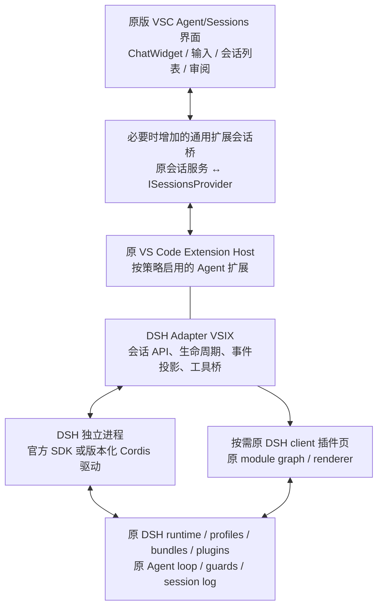

<!-- Copyright (c) Microsoft Corporation. All rights reserved. -->
<!-- Licensed under the MIT License. See LICENSE.txt in the project root for license information. -->

# ADR-001：Agent First，DSH 由 VS Code 插件适配

日期：2026-10-29。状态：产品方向已由用户确认；下述机制的运行实现与兼容性仍待验收。依据：用户明确要求 VSC 本体以裁剪为主、禁用编辑器专用插件、不主动加载 editor-only 组件，DSH 通过兼容层/插件层接入，双方持续同步上游。

本决策收窄此前 [可行性报告](feasibility/README.md) 中“广泛插件兼容，可恢复通用兼容工作区”的候选范围。原报告保留为研究记录；新产品不通过恢复常规 IDE 来兼容编辑器插件。Tauri 仍是待验证容器，不能替代原组件/原插件行为门禁。

## 1. 决策

1. VSC 保留原版 Agent/Sessions、ChatWidget、ChatInputPart、必要的 Monaco/文本模型/diff、扩展宿主及真实 API 对端。以入口、贡献注册、发布清单与激活策略裁剪，不复制重写核心组件，不重造 `vscode` API。
2. 编辑器专用插件默认禁止激活；新产品不加载它们的可执行入口。编辑器专用部件不进入主动启动链；被原 Agent 输入、代码块、上下文或审阅真正依赖的编辑器底层列入必要集合。
3. DSH 适配器优先是一个自有 VS Code 扩展，通过原扩展机制分发、启用和升级；DSH 插件继续由匹配版本的 DSH/Cordis/profile/bundle 原生加载。
4. 扩展拥有 DSH 运行时的选择、启动、协议、展示投影与用户交互；DSH 原运行时拥有 Agent loop、工具执行链、hook、模型、上下文、审批判定和持久化。初期采用独立进程，不把 DSH 全依赖装进共享 Extension Host。
5. 若原 Agents Window 无法接纳扩展会话，允许增加一层**通用扩展会话桥**。该桥不识别 DSH 包名/事件，不执行模型或插件；DSH 专属逻辑全部留在适配器扩展和 DSH 侧驱动插件。
6. VS Code 与 DSH 独立锁版本和升级，桥接协议单独版本化。产品以完整兼容元组发布和回退；不要求每次更新 DSH 都修改 VSC 核心。

## 2. 架构与职责

| 层 | 负责什么 | 不承担什么 |
| --- | --- | --- |
| VSC 产品层 | 原组件、Agent First 布局、插件准入、组件加载清单、通用会话入口 | DSH 插件解释器、DSH 专属事件和 Agent loop |
| 原扩展宿主/API | 原扩展激活、命令/配置、工具、UI/API RPC 与 Disposable | 手写兼容桩、对任意插件内部行为的自动沙箱 |
| DSH Adapter VSIX | 注册会话类型/内容、启动运行时、模型/profile 选项、流式投影、审批/提问、取消/恢复、管理命令、诊断 | 重做 DSH loop、按插件逐个翻译 Cordis API |
| DSH 侧驱动插件 | 补足 UI 所需的会话控制和事件协议，调用原公共服务 | 修改循环私有字段、用杀全进程冒充逐会话取消 |
| 原 DSH 运行时 | 原插件依赖/注入、profile/patch、执行与权限、原 session log | 被替换成一个 VSC LanguageModel provider 后仍声称完整 harness 兼容 |

DSH 适配器可以按自己的版本更新。初期作为产品配套扩展，使用明确的 proposed API allowlist；不能因为它是 VSIX 就宣称在任意官方 VS Code 稳定版中完整可用。后续若有稳定 API，可以独立制作通用版本，不能把“在自有产品中可更新”与“在任何 VSC 发行版都可安装”混为一谈。

## 3. 已核实的接入点与剩余缺口

### 3.1 原扩展 API 存在会话接入路径

本仓库 [chatSessionsProvider 声明](../../src/vscode-dts/vscode.proposed.chatSessionsProvider.d.ts) 提供 `createChatSessionItemController`、`registerChatSessionContentProvider`；旧 `registerChatSessionItemProvider` 已标记 deprecated。原 [Copilot chatSessions.ts](../../extensions/copilot/src/extension/chatSessions/vscode-node/chatSessions.ts) 正在通过扩展注册会话内容，说明此路径有现有实现可参照，无需自建聊天组件。

该会话 API 当前是 proposed。原 [extHost.api.impl.ts](../../src/vs/workbench/api/common/extHost.api.impl.ts) 会检查 `chatSessionsProvider`，原 [extensionsProposedApi.ts](../../src/vs/workbench/services/extensions/common/extensionsProposedApi.ts) 支持按产品和扩展 ID 列出允许的 proposal。适配器只申请必要 proposal，跟随固定 VSC SHA 编译和回归，不能为所有插件全局开启 proposed/private API。[官方 API 政策](https://code.visualstudio.com/api/advanced-topics/using-proposed-api)

官方 AI 扩展指南已把旧 Chat Participants 路线标为 deprecated，并鼓励通过 Agent plugin/tools 扩展现有体验。当前原会话注册仍需要一个 participant 参数，可将其限制为版本化 dispatch 包装；不把独立 `@dsh` 聊天当作完整 Sessions 集成，也不假定此接缝永远稳定。升级时跟随原会话/provider 机制，DSH 原 loop 和插件行为仍由独立运行时保留。[官方 AI 扩展概览](https://code.visualstudio.com/api/extension-guides/ai/ai-extensibility-overview)

本次新增 [编译探针](feasibility/evidence/dsh-vscode-api-probe.ts)，直接使用原版稳定/proposed `.d.ts` 严格编译，验证会话注册和 `lm.invokeTool` 的类型接缝；没有用假的 `vscode` 模块或跳过声明检查。编译通过仅说明当前类型契约可表达，不表示扩展已安装、主界面可见或真实 DSH 已接入。

### 3.2 Agents Window 还不能假定自动显示任意扩展会话

原 [Sessions 规范](../../src/vs/sessions/SESSIONS.md) 用 `ISessionsProvider` 路由后端；现有 [Copilot Chat provider](../../src/vs/sessions/contrib/providers/copilotChatSessions/COPILOT_CHAT_SESSIONS_PROVIDER.md) 明确只接 Copilot Cloud，局部 CLI 会话由 Agent Host provider 负责。注册 workbench 的 `chatSessions` 不自动等于进入原 Agents Window。

所以首个原型必须验证：适配器注册的 DSH 类型出现在原会话列表和新建入口、由原聊天组件发送/恢复，身份及路由不串用。如缺少投影，增加独立的通用 `extensionSessions` provider，将已准入扩展会话接到原服务；不能复制 Copilot Cloud provider 后堆 DSH 特例，也不能令通用 workbench 反向导入 sessions。

这一桥接需要的代码量尚未实测。产品仍以裁剪为主，但不能承诺零新增底层代码。若门禁发现必须大改 VSC Chat/API 核心，应先审查 provider 边界，不立即扩展新聊天页面。

### 3.3 DSH 保持自己的 harness

官方 DSH SDK 已提供独立进程、命名 profile、事件、恢复、审批与问题接入，可作为第一步。固定版本还缺逐会话关闭/中途取消 RPC，后续由 DSH 侧 Cordis 驱动补足；驱动通过原 `Agent.cancel`、拥有者 handle 等公共服务实现。不要把 DSH 仅注册为一个模型 provider 再由 VSC 循环驱动，否则 DSH 的 hook、compaction、workflow 和策略链不会自然保留。[DSH SDK](https://github.com/deepseek-ai/deepseek-harness/blob/f3803c96974ad4a94195fb97e5c637e9c2a3afe3/packages/sdk/client/README.md)、[原协议驱动模式](https://github.com/deepseek-ai/deepseek-harness/blob/f3803c96974ad4a94195fb97e5c637e9c2a3afe3/docs/cookbook/extension-cookbook.md)

## 4. Agent First 的插件和组件政策

“原生可用”指使用原 VSC API/宿主和被保留的 Agent 贡献点；不代表任何自称 Agent 的插件都无需验证。原 [Sessions manifest 服务](../../src/vs/workbench/services/extensions/common/extensionManifestPropertiesService.ts) 已有贡献点、缺失界面和支持声明的筛选机制，应尽量复用并以产品策略收紧。

| 类别 | 默认政策 | 验收 |
| --- | --- | --- |
| 声明式 Agent 资源、MCP、tools、skills 等 | 格式/范围匹配后通过原路径加载 | 原工具/资源可发现、调用、禁用，错误和权限不变 |
| 仅依赖保留 API 的可执行 Agent 扩展 | 准入后按需激活，运行于原宿主 | 真任务、恢复、取消、禁用/卸载和依赖检查 |
| 编辑器专用插件 | 禁止激活；自有分发清单不包含其可执行包 | `*`、startup、语言事件、命令、extension dependency 都不能绕过 |
| 混合 Agent/编辑器插件 | 默认不自动启用，按整体激活行为审计；无法隔离时禁用或由作者拆包 | 不因包含 tool 贡献而允许其激活路径加载编辑器功能 |
| 原 Agent UI 依赖的编辑器底层 | 明确列为必要集合，例如聊天输入、文本模型、只读 diff | 每项有原调用链和首次加载原因；不以路径含 editor 直接排除 |
| 纯编辑器 UI/贡献模块 | 不进入主动导入/初始化入口，源码仍保留供上游同步 | 启动、创建/切换会话、工具运行的运行时加载负向清单通过 |

插件禁用是整个扩展入口和依赖的准入规则；通常不能安全地只关闭一个 manifest 贡献点，再假定其 Node 代码不会运行。`extensionPack` 只是包集合，不等于允许其成员激活；被禁用的运行依赖不能由 Agent 插件间接拉起。

内置扩展也适用这些规则。Copilot 等本身可能是混合扩展，应核对原 Agent-window 启动路径、静态导入和条件贡献；不能仅凭“内置/官方”绕过 editor-only 加载门禁。尽量使用上游已有模式和延迟激活；确需拆启动贡献时保留小补丁与对照证据，不宣称启用全部 Copilot 包就已完成 Agent First。

组件裁剪需要静态和动态两种证据。原 `sessions.common.main.ts` 仍有 `editor.all` 副作用导入，不能仅隐藏 UI 后宣称按需加载。先从原版入口建立正确性对照，再逐项拆出必要注册、移除 editor-only 的启动引用；保留原实现路径，记录实际模块/worker/服务创建。静态留在 bundle 中、运行时被 evaluate、服务被实例化和功能被激活是不同状态，应分别统计。

## 5. DSH 行为一致性的承诺与验证

优先保证同 DSH SHA、profile、包锁、模型/参数、工作目录、策略/凭据作用域和持久化下的**可观察行为一致**。UI 可以使用 VSC 原组件，模型自然语言输出也不保证逐字节一致；确定性 fixture 验证事件与副作用，真实模型验证工作流和策略。

| 能力 | 一致性要求 |
| --- | --- |
| 工具/hook/guard | 使用原执行链；顺序、deny、一次性批准、结果/error/取消与对照一致，不静默略过 hook |
| 模型、context、prompt、compaction、subagent/workflow | 保留原服务和组合，不把插件降级成只导出 tool schema |
| 输入、并发、取消 | 区分消息入队、step/turn、整个 Agent idle；取消 A 不伤 B，迟到批准失效 |
| session/恢复 | DSH 原日志是权威；VSC 是投影；未支持的事件保留原始来源，不改成虚假“完成” |
| profile/bundle、安装/更新/禁用 | 原 loader/manager 处理，实际失败状态可见；不默认全事务回滚，不擅改覆盖顺序 |
| DSH 前端插件 | 原 client graph/React/renderer 按需承载在 Agent 插件页；API/资源/加载图不齐时明确受限，不声称自动映射为 VSC 组件 |

后端插件与原生 DSH 的契约应尽可能一致；前端视觉布局不能承诺与 DSH 原桌面完全相同。需要 UI 依赖的 DSH 插件保留原页面承载方案，无须为了这些插件恢复常规编辑工作台。

## 6. 双上游与独立升级

| 层 | 主要更新入口 | 必须回归 |
| --- | --- | --- |
| VSC 上游 | 原历史与小型裁剪/准入/通用桥补丁 | 原组件、Agent 插件、负向加载清单、provider/ExtHost API |
| DSH Adapter VSIX | 自有扩展发行版本 | 固定 VSC API/proposals、协议、展示与生命周期 |
| DSH 原运行时与插件锁 | 固定 DSH SHA/release、完整 profile/包锁 | 原插件行为、事件、控制/恢复、原 client graph |
| DSH Cordis driver | 自有插件版本 | 与原 service/event API 及 bridge protocol 的版本配对 |

适配器启动前检查支持矩阵，未知组合明确拒绝/受限；没有隐式下载 latest 或全局依赖提升。不混用两边 node_modules；不承诺 Extension Host 所用 Node/Electron ABI 自动适合 DSH 包。首次明确选择 DSH 或使用其能力才启动对应进程，未启用 DSH 时不为了发现插件启动其模型/loop。

DSH 更新先在隔离 home/profile/依赖中验证，成功后发布配套版本元组；失败恢复旧运行时与插件锁，发生数据迁移时同时使用匹配备份。VSC 更新不应修改 DSH 插件业务代码；DSH 更新也不应在 VSC ChatWidget 中出现 provider 专属修改。

## 7. 首轮推进与验收

| 编号 | 交付 | 通过条件 |
| --- | --- | --- |
| AF-01 | 原组件基线与准入规则 | 原 ChatWidget/Input/列表真实运行；编辑器专用与依赖绕过样本均未激活 |
| AF-02 | 原入口组件裁剪 | Agent 核心任务通过；editor-only 启动模块/worker/服务未加载，必要 Monaco 依赖有来源 |
| AF-03 | 最小 DSH Adapter VSIX + 通用会话接入 | 原 Agent 列表、新建、聊天、恢复和路由可用，不新增仿写聊天 UI |
| AF-04 | 原 DSH 插件 + 控制驱动 | 同 profile/包锁下工具、hook、context/compaction、审批、取消/恢复与原生对照通过 |
| AF-05 | 原 client 插件页及工具桥 | 前后端按能力标级；跨桥保留权限、结果类型与取消，不支持时明确拒绝 |
| AF-06 | 双上游独立升级与回滚 | 分别更换 VSC、DSH 提交运行回归；DSH 升级仅修改扩展/驱动/锁范围，VSC 核心保持 provider-neutral |

当前仅会话 API 编译探针通过，AF-01–06 运行门禁均未执行。建议下一工作包先完成 AF-01/03 最小链路和 AF-02 的加载基线，遇到 proposed API/主列表断点时用通用桥补齐；之后才扩展 DSH 深度插件和前端覆盖。已有 Host/协议/认证成果保留独立证据，不把它们当作上述门禁已完成。

## 8. 与旧计划的关系

`GOALS.md` 与 `SOLUTION.md` 已按本决策更新产品边界；原测试成绩和里程碑状态保持。旧“默认不加载 Monaco”“发布物必须无 Electron”“React + 手写 API 子集”不再作为本方向的实现约束；保留原 Agent 必要依赖、容器经证据选择。原性能百分比未实测且不因本决策改为通过，重新设定预算必须在优化实施前记录同能力基线和理由。

F0–F4 仍用于阶段组织，AF-01–06 是本方向的必选门禁；[原七组 PoC](feasibility/POC_PLAN.md) 中恢复一般编辑器兼容区、把 Cline/Continue 整包作为默认必选等内容，改按本 ADR 的 Agent First 准入范围解释。编辑器专用插件的正确结果是未激活，不是设法在产品里打开 IDE。
