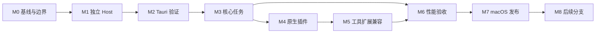

<!-- Copyright (c) Microsoft Corporation. All rights reserved. -->
<!-- Licensed under the MIT License. See LICENSE.txt in the project root for license information. -->

# Agent 专用客户端 Roadmap

## 人工交付顺序（当前优先）

遵循 [HUMAN_ACCEPTANCE](HUMAN_ACCEPTANCE.md)：H1 剪裁后的 VSC Agent → H2 最小 DSH Bridge → H3 导入 DSH 插件 → H4 完整 Agent，分四次交付；只有用户明确确认才标人工通过。当前先闭合 H1，DSH 保留且未启用。

已整合 [Mac 准入复验](evidence/AF/H1/2026-10-30-mac-admission-retest/README.md)（文档 78b70f4、实际产品 09c0374）：原 native EH 正常启动/退出，实际请求并完成 chat-participant 激活，空清单下无可执行扩展激活；中文多行 paste 和一条文件只读路径通过。历史 0bec73f 失败保留。该结果是源码启动与限定准入证明，不是完整 H1 验收。

最新 [窗口/恢复/资源拖放工作包](evidence/AF/H1/2026-10-30-window-resource-drop/README.md) 已在 canonicalization 前校验原生打开意图，收紧 CLI 单文件夹结果与旧编辑器窗口恢复，防止资源拖放进入普通 workspace 或注入未保存编辑器内容。26 项纯函数路由/恢复测试、13 项原资源拖放 service 测试及原界面/Worker 加载探针通过；新的 Mac OS 打开、恢复和物理拖放矩阵仍待验证。

H1 仍为工程进行中，尚不可提交人工验收。外部 VSIX 原生负向用例由本机推进；真实任务、完整加载归因、系统 IME/VoiceOver、独立 Mac 包及其他门禁未完成。见 [H1 证据索引](evidence/AF/H1/README.md) 与 [NEXT](evidence/AF/H1/NEXT.md)。OAuth 不阻塞独立源码工作，Linux/fixture 不替代 native/真实模型结果。

当前采用 [ADR-001](ADR-001-agent-first-dsh-extension.md) 确定的 Agent First 路线：原组件/原宿主 → 编辑器插件准入与组件加载裁剪 → DSH Adapter VSIX 接入原会话界面 → 原 DSH 插件行为 → 双上游升级与性能发行。编辑器专用插件禁用，不通过恢复通用 IDE 扩大兼容；DSH 专属逻辑在插件/驱动层。

## 当前工作顺序

| 阶段 | 当前目标 | 对应旧里程碑 | 必选门禁 |
| --- | --- | --- | --- |
| F0 | 原组件、原宿主和 Agent First 清单基线 | M0、M2、M5 重新核对范围 | AF-01，AF-02 加载基线 |
| F1 | 最小 DSH VSIX + 通用会话接入 + 原运行时链路 | M2 至 M5 的新架构验证 | AF-03，AF-04 首轮；Tauri 同组件实验另记 |
| F2 | Agent 准入/组件裁剪、完整 DSH 交互与原插件行为 | M3 至 M5 | AF-01/02 完整门禁，AF-04 |
| F3 | 原 DSH client 插件页、工具桥、独立升级 | M4、M5、M7 维护工程 | AF-05/06 |
| F4 | 同能力性能、最终容器与 Mac 发行 | M6、M7 | G01 至 G12 与 AF 门禁、签名/真实账户/干净机器 |

每项输入、交付物、验收和失败处理见 [ADR](ADR-001-agent-first-dsh-extension.md#7-首轮推进与验收) 与 [PoC 工作包](feasibility/POC_PLAN.md)。全部新运行门禁待执行；已有协议、Host 和原型测试保留准确的提交/平台边界。下一步先做 AF-01/03 最小原组件与会话链路，再逐项裁剪并扩展 DSH，不继续扩大 React 仿写页面。

## 原 M0–M8 阶段与交付物

以下保留早期原型路线与交付编号供核对。其 Tauri 固定选型、轻量前端和 API 子集等旧技术约束由 ADR-001 取代；已有真实测试/账户/签名门禁不因此取消，里程碑不自动改为已验收。

| 里程碑 | 主要目标 | 前置条件 | 可验收交付物 | 退出门禁 |
| --- | --- | --- | --- | --- |
| [M0](milestones/M0-baseline.md) | 确定能力和性能基线 | 当前源码可读；真实账户测试具备条件 | 能力矩阵、依赖清单、扩展候选清单、基线报告、首轮决策记录 | G01 至 G12 有验证计划；每项能力有首版或后续归属；性能测量能复现 |
| [M1](milestones/M1-standalone-host.md) | 独立提取和分发运行时 | M0 工程审计通过；Mac 基线另行补验 | 单独构建的 Node Agent Host、资源与原生依赖清单、真实 Copilot 连通记录 | 不依赖 VS Code 安装或 Electron 进程，完成无界面任务；测试与开发依赖不进入产物 |
| [M2](milestones/M2-tauri-client.md) | 验证 Tauri 和 AHP 路线 | M1；M0 可先准备界面原型 | Tauri 应用、进程管理、AHP 适配、登录与重连原型 | 真机完成登录、会话、流式响应、取消与重连；WKWebView 关键交互通过 |
| [M3](milestones/M3-agent-workflow.md) | 完成本地 Agent 任务流程 | M2 | 会话管理、权限交互、文件上下文、命令结果、Diff、检查点或可用的变更恢复 | 固定任务中完成读取、修改、命令、审阅、恢复；拒绝和中断路径也通过 |
| [M4](milestones/M4-agent-plugins.md) | 保留原生 Agent 扩展能力 | M3；插件适配可在 M2 后准备 | MCP、Skills、Agents、指令、Prompts、Hooks 和插件管理 | 测试插件可安装、发现、调用、禁用、卸载与重启恢复；账户与项目作用域不串用 |
| [M5](milestones/M5-extension-compatibility.md) | 保留适用的 VS Code Agent 工具扩展和富交互 | M3、M4 | 扩展兼容清单、按需 Node 扩展宿主、工具桥接、浏览器工具和 Canvas 适配报告 | 兼容样本通过，编辑器扩展不激活；首版富交互项通过，未支持项准确标示 |
| [M6](milestones/M6-performance.md) | 验证瘦身收益 | M3 至 M5 的首版能力稳定 | 依赖与包体报告、性能结果、热点优化、回归预算 | G09 性能目标和 G10 裁剪要求通过，且功能覆盖不下降 |
| [M7](milestones/M7-macos-release.md) | 交付 macOS 独立应用 | M6 | 签名与公证产物、安装更新流程、诊断包、上游同步流程和用户说明 | 全部首版目标通过；干净机器实测；升级与回退数据兼容通过 |
| [M8](milestones/M8-follow-up.md) | 其他平台和有证据的原生化 | M7 | 按分支立项的网页、Windows、Linux 或 Rust 热点替换 | 每个分支独立满足功能与性能条件，不改变首版已发布承诺 |

## 依赖图

兼容性审计和性能采样从 M0 开始贯穿全程。图中的顺序表示验收依赖，不要求所有准备工作串行；功能不完整时的性能结果只能作为诊断，不能作为 M6 最终成绩。

## 三个阶段成果

| 阶段成果 | 包含里程碑 | 应当能展示的结果 |
| --- | --- | --- |
| 技术可行性 | M0 至 M2 | 一台不运行 VS Code 的 Mac，通过 Tauri 控制独立 Copilot Agent Host |
| 日常任务可用 | M3 至 M5 | 对项目执行真实修改，审阅结果，并使用选定的 Agent 插件和工具扩展 |
| 可发布产品 | M6 至 M7 | 在保持约定能力的情况下，体积、资源和启动改善达到目标，且可独立安装更新 |

## 关键决策门禁

- M0 明确 Copilot Agent Host 与旧 Local harness 的能力差异。缺失的编辑器上下文、语言诊断或云能力必须有替代方案或后续归属。
- M1 核实 Copilot 登录、所需服务配置和运行时能否在自有应用中实际工作。源码可编译与真实账户可用分别验收。
- M2 决定是否继续使用 Tauri。若关键工具或交互依赖 Electron 专有机制，先完成替代验证；仍不可用则保留 Host 成果，记录客户端选型调整，不无限增加 Tauri 适配层。
- M5 用真实扩展依赖确定兼容上限。Agent 贡献点是候选筛选条件，运行验证才是兼容结论；无法兼容的首版必选扩展会阻塞该门禁。
- M6 验证完整能力的资源收益。不能通过删除必选扩展、漏算浏览器进程或把必需运行时改成下载项来达标。

## 范围和排期

首版平台为 macOS arm64；macOS x64、网页和其他桌面平台进入 M8。早期原型为 Tauri 2、Rust、React 与独立 Node Host；当前主线改为原 VSC Agent 组件/宿主 + DSH VSIX/原运行时，最终容器通过同能力验证决定。精确依赖版本锁定，不追踪未固定的 latest。

实施主要在 Codex 云端推进。M0 拆分为工程审计和 Mac 基线：能力、依赖、测试设计与版本风险审计完成后，可进入 M1 的独立构建实现；缺少 Mac 的测量不能伪造或改为 Linux 成绩，M0 完整状态保持待验收。云端完成的 M1、M2 工作同样区分实现与最终验收，详见 [Codex 云端推进交接](CLOUD_HANDOFF.md)。

暂不承诺日历日期。M0 完成后以工作包估算工期；M2 和 M5 分别是客户端适配和扩展兼容的主要不确定性。计划变化必须写明受影响目标、已经投入的工作以及新的验收路径。

## 统一完成定义

- 交付物可从记录的提交构建，步骤不依赖个人目录、开发机缓存或现有 VS Code 安装。
- 目标矩阵中的对应场景通过，并提供结果记录；“暂不支持”不能代替必选能力的通过证据。
- 已记录失败场景、剩余限制与恢复方式，无未处理的数据丢失或权限绕过问题。
- 推进文档的状态、交付物和下一步同步更新。只有证据齐全才改为“已验收”。

## 2026-10-28 工程推进

M0 工程审计完成、完整基线待 Mac 验收；M1 的首个独立 Node Host 构建与确定性验证已落地于 `packages/agent-host/`。证据见 [M0](evidence/M0/README.md) 与 [M1](evidence/M1/README.md)。下一工作包为 [M1-B](evidence/M1/NEXT.md)，先闭合真实 Copilot、故障恢复和目标平台分发门禁；M2 与后续里程碑不因本次构建成功而自动完成。

用户续作授权后，M2.1–M2.3 和 M2.5 的云端工程与 M1 剩余验收并行推进：官方 AHP SDK、Tauri 外壳、进程管理和确定性测试已落地。M2.4 原生账户/Keychain 适配尚未实现，M2.6 WKWebView 与真实 Mac 生命周期未验收。见 [M2 报告](evidence/M2/README.md)，完整门禁不变。
