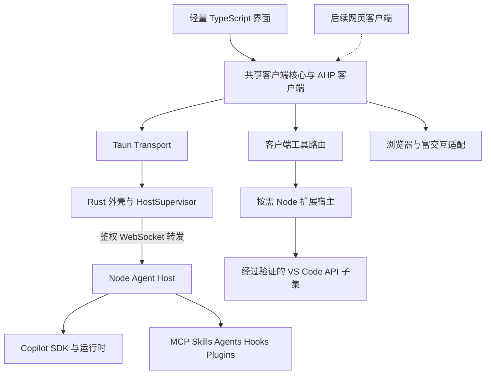

<!-- Copyright (c) Microsoft Corporation. All rights reserved. -->
<!-- Licensed under the MIT License. See LICENSE.txt in the project root for license information. -->

# Agent 专用客户端方案总结

推荐建设独立的 Tauri 应用，复用现有 Node Agent Host，通过 Agent Host Protocol（AHP）管理 Copilot 任务。重新实现 Agent 专用界面，按实际依赖保留 Agent 扩展能力。Rust 首先承担外壳、进程生命周期和系统集成；后端热点是否改写由实测决定。

## 产品形态

主界面由项目、会话列表、聊天、工具执行记录、变更审阅和设置组成。用户可以给 Agent 分配任务、回答问题、控制权限并审阅成果，无需进入常规 IDE。文件修改由 Agent 工具完成，文件和 Diff 默认只读；需要手动编辑时可以显式用外部编辑器打开。

首版面向 macOS arm64，使用 Tauri 2 和系统 WKWebView。独立安装包包含或管理必要的 Node 与 Copilot 运行时，不要求用户安装 VS Code 或系统 Node。关闭窗口保留应用与任务运行；完整退出时对活跃任务提供等待或停止的明确选择，再关闭自有进程。首版不引入独立于应用运行的常驻 daemon。

## 架构和责任

| 组件 | 负责的行为 | 约束 |
| --- | --- | --- |
| TypeScript 前端 | 聊天、输入、会话、工具结果、审批表单、Diff 和设置 | 建议使用 React 与 Vite；不导入通用 workbench 或 `editor.all`；长列表虚拟化 |
| 共享客户端核心 | 官方 AHP TypeScript 客户端、订阅、协议状态与界面投影 | Host 是持久状态权威；只使用一套客户端 reducer，不在 Rust 再维护另一份会话状态 |
| Rust 外壳 | 窗口、Keychain 集成、宿主启动停止、连接令牌和 WebSocket 转发 | 凭据留在原生侧；转发保留 AHP 帧语义；队列有界，溢出后重同步而不丢事件继续运行 |
| Node Agent Host | Copilot 适配、会话状态、工具权限、文件与 Git、持久化、协议服务 | 尽量复用上游；新增独立构建入口；补齐 worker、动态资源和原生模块 |
| 扩展宿主 | 运行兼容清单中的 JavaScript Agent 工具扩展 | 第一次使用才启动；无扩展需求时不常驻；不承诺任意 VSIX 兼容 |
| 原生 Agent 插件与富交互 | MCP、Skills 等资源及浏览器、Canvas 的独立适配 | 按运行时和能力协商启用；浏览器客户端不自动获得桌面专属能力 |

Node 扩展执行的是受信任的本机代码。Tauri capability 约束 WebView 调用原生接口，不等于给 Node 扩展、MCP 进程或命令执行建立沙箱；相应能力沿用 Host 和运行时权限，并明确安装来源及授权范围。

## 复用与重写

| 对象 | 处理方式 |
| --- | --- |
| `src/vs/platform/agentHost` | 主要复用，提取运行与构建边界；先以 Copilot 单 provider 分发，不删除其他 provider 源码 |
| `src/vs/base`、必要的 `src/vs/platform` | 保留被依赖的基础服务；为环境、产品配置、文件、日志和存储提供独立启动配置 |
| `editor/common` 的文本和 Diff 能力 | 按实际依赖保留；worker 入口须单独纳入产物分析 |
| `src/vs/sessions` | 参考会话模型与交互行为；不直接加载其完整桌面入口 |
| 聊天与审阅界面 | 使用轻量组件重写；优先虚拟化、增量渲染和明确的状态归属 |
| VS Code 扩展 API | 优先复用可独立运行的部分；只提供兼容清单所需子集，不以空实现伪装支持 |
| 编辑器、补全、调试及普通工作台扩展 | 从发布和激活清单移除；源码暂保留以便对照、提取和同步上游 |

当前 Sessions 入口加载完整编辑器，见 [sessions.common.main.ts](../../src/vs/sessions/sessions.common.main.ts)。独立服务入口见 [agentHostServerMain.ts](../../src/vs/platform/agentHost/node/agentHostServerMain.ts)。服务构造边界见 [serviceBootstrapping.md](../../src/vs/platform/agentHost/node/serviceBootstrapping.md)。Diff worker 仍依赖底层编辑器算法，见 [diffWorkerMain.ts](../../src/vs/platform/agentHost/node/diffWorkerMain.ts)。

## 接口与数据流

- 前端使用共享 `AgentTransport` 抽象：桌面走 Tauri 转发，后续网页走经过鉴权的 WebSocket。正式方法及类型在 M2 依据锁定的 AHP 客户端确定，不复制手写协议类型。
- Rust 的 `HostSupervisor` 区分应用拥有的 Host 与外部连接。只有自有进程可以被自动停止；首版默认自有本地 Host，外部和远程连接留给后续阶段。
- AHP 通过版本协商使用实际发布的兼容基线，不能把当前源码里的开发版本常量当成所有 SDK 都支持的版本。各版本和 capability 记录在构建清单中。
- AHP 的会话、聊天、终端、changeset 和工具请求映射成界面状态；工具调用按实际来源路由到 Host、原生插件或客户端扩展。
- Host 已确认的状态负责持久化；前端仅保存布局、草稿和显示偏好。断线恢复先同步状态，有副作用的未知结果请求不自动重发。
- Copilot 账户登录与本地 Host 连接令牌分别管理。登录实现使用受支持的流程，不依赖复制 VS Code 凭据或开发机已有登录状态。

## Agent 扩展兼容策略

第一层直接保留原生 Agent 资源，包括协议和运行时支持的 MCP、Skills、自定义 Agent、指令、Prompts、Hooks 和插件。第二层按需启动精简 Node 扩展宿主，接纳已经验证的 VS Code 工具扩展。第三层针对浏览器、Canvas 和混合扩展提供单独适配，明确到每项能力。

现有 [扩展筛选逻辑](../../src/vs/workbench/services/extensions/common/extensionManifestPropertiesService.ts) 提供 Agent 贡献点与缺失工作台特征检查，可作为审计入口。扩展即使声明支持 Agent 窗口，也可能在运行时调用活动编辑器、语言诊断、Webview 或调试 API，因此必须验证实际依赖。

首版至少覆盖工具、MCP 提供和声明式资源三类扩展样本。M0 增加真实候选扩展及固定版本；M5 对每个必选扩展给出兼容、拆分适配或阻塞结论。没有通过运行验证的扩展不进入支持清单。

## Tauri 与 Rust 的采用条件

Tauri 的主要机会是减少随包浏览器引擎和 IDE 前端负担。仍需计入系统 WebView 进程、Node Host、Copilot 运行时与插件，因此不能仅凭外壳体积预测总内存。应用能否达到性能目标，以 M6 的同能力比较为准。

优先优化不必要的初始化、扩展激活、历史扫描、重复状态和渲染，再决定是否把 Diff、搜索或存储等热点改写为 Rust。替换必须保留协议、结果和错误语义，并通过确定性对照。全量 Rust 重写、替换 Copilot 推理循环、重建通用 IDE 均不进入首版。

若 WKWebView 的关键能力无法满足首版，M2 记录问题并调整客户端方案；独立 Host、协议适配和测试资产继续复用。若必须保留的工具扩展导致精简宿主规模过大，M5 比较转为 MCP、拆分扩展与保留兼容宿主的成本，并保留可运行的原生插件模式。

## 首版与后续能力

首版交付定义在 [GOALS.md](GOALS.md)，完整路线见 [ROADMAP.md](ROADMAP.md)。网页客户端、Windows、Linux、多 provider、远程连接和热点原生化进入 M8。云端会话、自动化调度、电脑操作等能力由 M0 单独归类，未列入首版必选清单时不得宣传已经覆盖。

## 参考资料

- [VS Code Agent Host architecture](https://code.visualstudio.com/docs/agents/concepts/agent-host)：独立 Host、AHP 与客户端工具的职责。
- [Agent Host Protocol](https://github.com/microsoft/agent-host-protocol)：官方客户端和协议定义。
- [Tauri sidecar](https://v2.tauri.app/develop/sidecar/)：按目标架构分发和启动外部运行时。
- [Tauri capabilities](https://v2.tauri.app/security/capabilities/)：WebView 与宿主接口的权限边界。
- [Copilot SDK](https://github.com/github/copilot-sdk)：运行时集成入口；客户端 SDK 不等于 VS Code 扩展兼容层。
