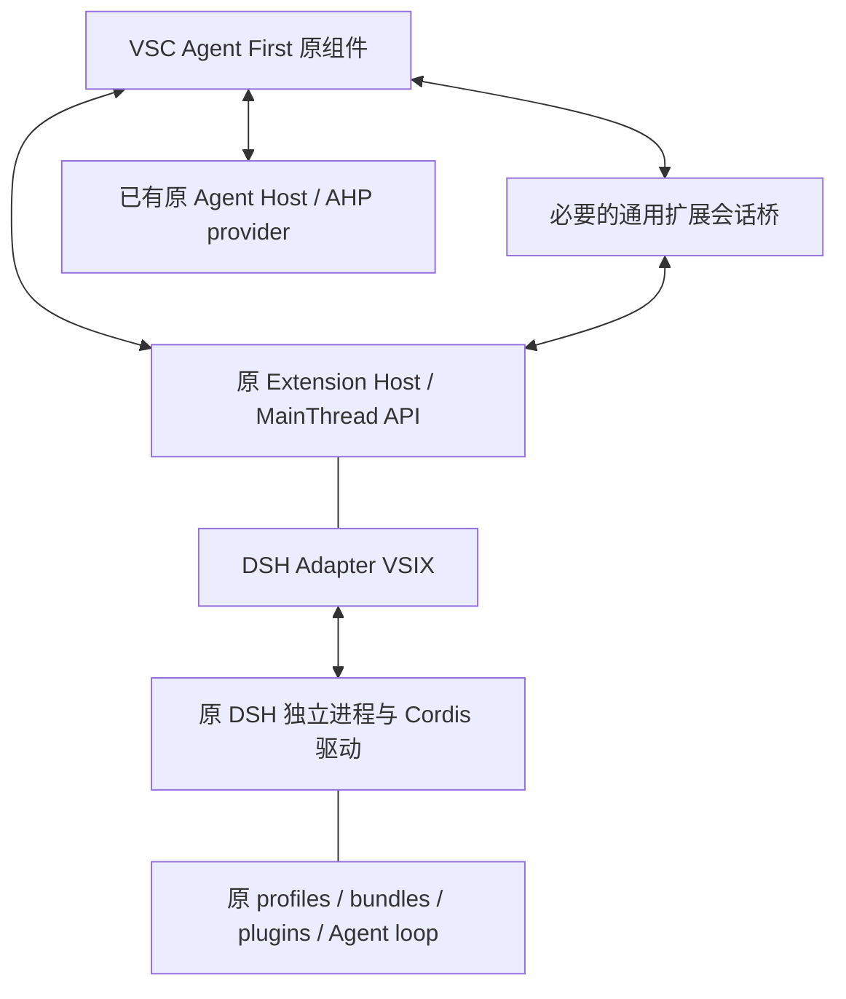

<!-- Copyright (c) Microsoft Corporation. All rights reserved. -->
<!-- Licensed under the MIT License. See LICENSE.txt in the project root for license information. -->

# Agent First 客户端方案总结

当前方向由 [ADR-001](ADR-001-agent-first-dsh-extension.md) 定义：VSC 本体以裁剪为主，直接复用原版 Agent/Sessions 组件与扩展宿主；禁用编辑器专用插件，不主动加载 editor-only 组件；DSH 由自有 VS Code 扩展适配，插件继续由原 DSH 运行时加载。VSC、适配器和 DSH 分别保留升级路径。

这是已确认的产品方向，不代表实现完成。已有 Tauri/React 原型和 Host、协议、认证工程保留其原证据；原 React 组件不是原 ChatWidget 的复用。新方向的门禁为 ADR 中 AF-01–06，全部运行门禁尚未执行；会话 API 类型接缝的编译探针已通过。

## 产品边界

主界面聚焦项目、会话、聊天、工具、权限、文件上下文、只读变更审阅和 Agent 插件管理。文件修改由 Agent 完成，手动编辑可用外部编辑器。首版不恢复通用代码编辑区、补全、调试、Notebook 和编辑器专用插件。

原聊天输入依赖的 Monaco、文本模型、代码块/diff 和文件/命令等基础服务可以保留；它们由真实 Agent 调用链决定。纯编辑器插件和部件的可执行入口、启动贡献与依赖激活必须被准入/裁剪规则阻断，不能仅隐藏入口。

首版仍优先 macOS arm64、独立安装运行，不要求用户另装 VS Code、Node 或 DSH。运行时可随包或由产品明确管理，计入完整安装占用。原版 Electron 平台用于建立正确性基线；Tauri 只在承载相同原组件、原扩展行为及平台门禁通过后采用，最终容器尚未决定。

## 分层架构

| 层 | 职责 | 升级边界 |
| --- | --- | --- |
| VSC 本体 | 原组件、真实 API、Agent First 布局、插件准入、组件加载策略、通用 provider 接入 | 保留原历史，产品差异集中为小补丁，不引入 DSH 专属业务 |
| DSH Adapter VSIX | 会话注册/投影、profile/model 选择、启动/停止、流式展示、审批/问题、工具桥和诊断 | 配套 VSC API/proposals 与桥协议独立更新 |
| DSH 侧 Cordis 驱动 | 对 UI 所需的控制/事件提供版本化接口，补齐 SDK 当前缺口 | 调用原 Agent/Session 服务，不修改 loop 私有实现 |
| 原 DSH runtime/插件 | 运行原工具、hook、上下文/compaction、模型、工作流及持久化 | 固定 release/SHA、profile、完整插件锁和 client graph |
| 原 Agent Host/AHP | 保留已有 Copilot/provider 能力和独立工程成果 | 与 DSH 协议分开，不把 AHP 当作 VS Code 扩展 RPC |

初期 DSH 使用独立进程，由适配器拥有其生命周期；不把全部 DSH 依赖装入共享 Extension Host。未选择 DSH/未使用其能力时不启动 DSH loop。普通 Node 插件仍是受信任代码，进程边界和 Tauri capability 不构成任意插件的完整 OS 沙箱。

## VS Code 插件准入与组件裁剪

复用 [原 manifest 服务](../../src/vs/workbench/services/extensions/common/extensionManifestPropertiesService.ts) 的 Agent 贡献点、缺失功能和支持声明检查，再按产品范围收紧。原生 Agent 插件使用原宿主/API，而不是“兼容清单所需 API 子集”的新实现。

- 声明式资源、MCP 和适用 Agent tools 走原路径；可执行插件通过真实依赖/工作流验证后按需激活。
- 编辑器专用插件不激活，自有发布清单不包含其可执行包；startup、语言事件、命令和运行依赖不能绕过。
- 混合插件默认不自动启用；按整个 activate/import 路径审计，无法隔离时禁用或让作者拆包。带有 Agent contribution 不自动获得准入。
- 组件分为 Agent 必要、共享依赖、editor-only。前两类按真实需求使用；editor-only 不进入主动初始化，源码保留便于合并上游。

原 Sessions 入口仍加载 `editor.all` 等副作用注册，需要先做加载基线再逐项裁剪。记录模块 evaluate、worker/服务创建和插件 activate，分别验证；静态 bundle 中存在、已执行和已激活不应混算。不得通过删除所有 editor 路径、再用新输入/审阅组件补回功能。

## DSH 适配器的具体接入

原扩展 API 已有 `createChatSessionItemController` 和 `registerChatSessionContentProvider`，可由 VSIX 注册会话列表/内容；原 Copilot 扩展有现成使用路径。该接口目前属于 `chatSessionsProvider` proposal，需要产品对配套扩展显式允许并锁定 VSC 版本。

原 Agents Window 通过 `ISessionsProvider` 路由，当前 Copilot Chat provider 只接 Cloud；注册扩展会话不等于会自动进入原主列表。先验证最小 DSH 会话链路；必要时增加通用扩展会话 provider，保持共享 Sessions/Workbench 不依赖 DSH 类型和包。不得通过另写聊天页面绕过这个门禁。

DSH 保留自己的 Agent loop。将它仅暴露为模型 provider 或只导出 tools，无法保持原 hook、上下文、compaction 和工作流行为。适配器应接完整会话/事件/控制；工具互通是附加能力。

DSH 当前 SDK 可先接入启动、profile、事件、审批、问题和恢复，但缺逐会话关闭/中途取消 RPC。完整交互通过自有 Cordis driver 或上游新增能力补齐；取消 A 不能影响 B，不能用 kill 共用 runtime 宣称实现了会话取消。

DSH 原 session log/profile 是持久化权威，VSC 保存显示投影、布局和自己的草稿。原 DSH 前端插件按需在 Agent 插件页承载原 client graph/renderer；缺失 UI 能力明确标级，不默认所有前端插件都能映射到 VSC 原组件。

## 行为一致性与权限

以相同 DSH SHA、profile、插件锁、工作目录、模型参数、权限配置为对照。确定性测试检查工具/事件顺序、hook/guard、审批拒绝、取消、结果类型、context/compaction、持久化和卸载；真实模型验证可观察工作流，不要求随机文本逐字相等。

工具桥经原 `vscode.lm`/DSH 执行链调用，保留来源、命名空间和执行拥有者。原 deny 不能被 UI 批准覆盖；取消后迟到的批准失效；参数变化需要重新授权；结果未知的写操作不自动重放。长期账户/模型凭据留在相应受控存储，不进入 renderer 或普通日志。

## 双上游同步与分发

保留 VSC 上游历史；原 Chat/API/扩展 RPC 尽量原样，产品差异集中在 composition root、准入、产品配置和通用桥。DSH 通过固定原运行时和自有驱动/适配器更新，不逐插件翻译原 API，不混用两边 node_modules。

每次发布记录完整版本元组：产品、VSC SHA/API proposals、容器、适配器、DSH SHA/version/profile/bundles/lock、驱动协议和数据格式。分别升级 VSC 与 DSH 并运行回归和数据回退演练；尽量做到 DSH 升级只变更插件/驱动/锁，VSC 核心不出现 DSH 专属补丁。

插件来源、商店和服务授权独立核对，沿用报告中的 [发行边界](feasibility/README.md#10-发行插件来源与许可边界)。原生 API 兼容不自动授权访问微软 Marketplace。依赖、插件与运行时均进入来源和完整性清单。

## 推进顺序

1. AF-01/02：原组件和原扩展宿主基线、插件准入与编辑器专用组件负向加载清单。
2. AF-03：最小 DSH Adapter VSIX，把会话接到原列表/聊天；必要的通用桥也在此验收。
3. AF-04：DSH 原插件、SDK/控制驱动、审批/取消/恢复的原生行为对照。
4. AF-05：工具互通、原 DSH client 插件页和诊断。
5. AF-06：两个上游独立升级、回滚；再做同能力性能与最终容器/发行验收。

目标见 [GOALS.md](GOALS.md)，阶段组织见 [ROADMAP.md](ROADMAP.md)，验收任务详见 [ADR-001](ADR-001-agent-first-dsh-extension.md) 与 [PoC 计划](feasibility/POC_PLAN.md)。此前性能百分比没有实测，不因新方向自动通过；同能力新基线和预算调整必须在优化实施前留下记录。
