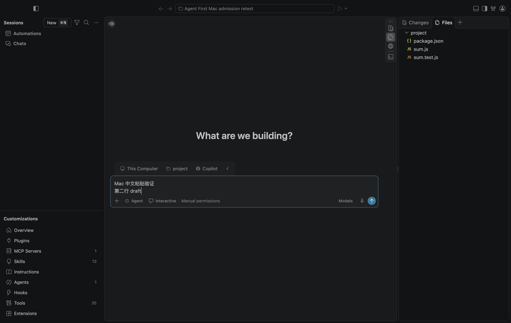
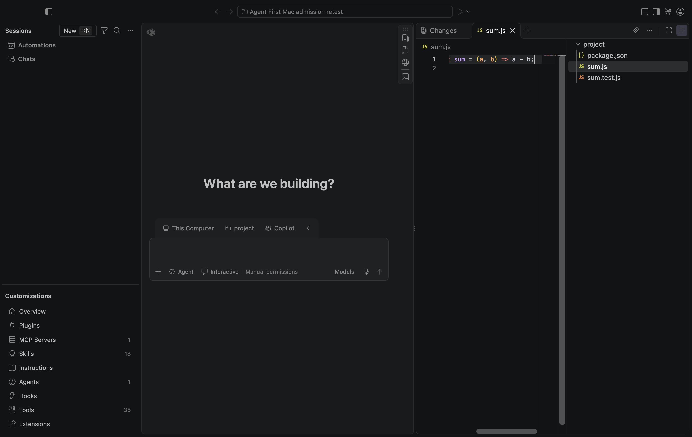

<!-- Copyright (c) Microsoft Corporation. All rights reserved. -->
<!-- Licensed under the MIT License. See LICENSE.txt in the project root for license information. -->

# H1：Mac 原生扩展准入修复复验

**已通过上次实际失败路径的 Mac 复验。H1 仍在工程进行中，未达到人工验收条件。**

日期：2026-10-30。实际运行源码 `09c03744303e2693251b4dd077851307b1b2d95a`，测试前源码工作区干净。云端 [修复与回归](../2026-10-30-native-admission-fix/README.md)之后，在同一台 macOS 27.2（26B123）arm64 / Node 24.22.1 / Electron 43.8.3 / Chromium 150.0.7871.250 上复测。此前 [0bec73f 的失败证据](../2026-10-30-mac-native/README.md)完整保留，不回写历史状态。

## 实际通过范围

| 检查 | 本轮原生观察 |
| --- | --- |
| 修复已进入本机输出 | `npm run build-fast -- --client-only` 退出 0，刷新 6 个输入路径；依赖、扩展和运行时输入未变，复用上轮完整构建，不重复下载/安装 |
| 原窗口与模式 | 原 `sessions-dev.html` 实际运行；Sessions=true、Agent First=true、可执行清单=[]、extension-development=false |
| 原聊天草稿 | 原 Chat 输入区域中文多行 paste 与读回成功；未发送 prompt |
| 原文件审阅 | 原 Files 打开临时 `sum.js`，按键 A 和粘贴 `H1_WRITE_PROBE` 后，可见 buffer 与磁盘内容均未变化 |
| 原生 EH 存活 | 同轮完整日志记录原生 Extension Host 启动、eager 完成，并在测试结束正常退出 0 |
| 明确触发原失败事件 | 通过实际原 `NativeExtensionService.activateByEvent('onChatParticipant:github.copilot.editsAgent')` 请求并完成；不是因未触发而忽略日志 |
| 扩展准入 | 原生服务注册表中没有 main/browser 可执行扩展；完整 EH 日志没有任何 `_doActivateExtension`，包括此前被错误放行的 `GitHub.copilot-chat` |
| 指定加载路径 | 本轮受控 reload 请求列表中，先前五个指定 editor/Notebook/Interactive/Search Editor/独立 Merge contribution 路径仍未请求；不扩展为任务全生命周期排除 |

这是对**空产品清单下，内置 Copilot 聊天参与者激活绕过**的原生关闭证据。外部 VSIX 的 saved-workspace/auto-enable/development/依赖路径仍只有云端 service 回归范围，不能由这一条 Mac 通过替代。

## 触发与日志的证据来源

使用 [launch skill](../../../../../../.agents/skills/launch/SKILL.md)，以新的空 User profile、仓库外临时项目、独立扩展目录、内存 SecretStorage 启动原 Electron。通过 CDP 等待实际 Sessions 页面，使用 skill 的可见 Chat 输入定位与 ClipboardEvent 路径复测草稿；先用原 Files 快捷键展开文件区域，再做原文件审阅检查。

为准确证明激活请求发生，测试 controller 仅在本轮临时 renderer 中用原 `registerAction2` 注册一个测试命令。F1 执行该命令，从**实际原生 DI**取 `IExtensionService`，等待原扩展扫描完成，调用原 `activateByEvent`，记录完成状态和只含 ID/可执行标志的注册表。没有新建模拟 ExtensionService、替换产品准入/服务实现、修改 allowlist、直调扩展模块、开启开发豁免或发送模型请求。测试命令随本轮进程退出；产品源码未增加测试入口。

请求完成后继续观察 6 秒，关闭本轮实例，再收集同一临时 profile 下完整 `exthost.log`，包括退出日志。日志有明确的原生进程启动/退出与正常初始化；不是空文件或失败启动。公开记录只替换仓库绝对路径，不裁掉 EH 激活行。

初次探针尝试在已创建的服务原型上观察 UI 命令，没有取得实际服务，明确激活未执行；首次 Files 也因区域未展开超时。这轮被标记为 [无结论](raw/initial-incomplete-probe.json)，没有计为准入通过或新产品故障。改用原 Action2/DI 命令和显式 Files 操作后，最终 controller 退出 0，完成上述路径。

## 本机复现与归档

本机工作目录为 `.build/agent-first-mac-admission-retest-20261030/`；`test-project.json` 指向独立临时示例项目，`empty-profile/` 仅包含测试设置。根依赖、原扩展/Copilot输出和 Electron 沿用上轮安装，客户端已更新为本轮修复。开发启动仍依赖本地仓库/输出，不是独立安装包。

```sh
export PATH="$PWD/.build/mac-toolchain/node-v24.22.1-darwin-arm64/bin:$PATH"
npm run build-fast -- --client-only
node docs/agent-client/evidence/AF/H1/2026-10-30-mac-admission-retest/raw/native-retest-controller.mjs
```

controller 是本轮实际执行快照，依赖上述本机 `.build` 中的 profile/项目描述；固定源码标识为 `09c0374`，后续版本需要另行确认源码并创建新记录，不能沿用其身份。外机应按原 launch skill 新建自己的隔离输入。执行原生窗口需允许本机 GUI/IPC。

- [validation.json](validation.json)：版本、实际通过项与未完成门禁。
- [native-smoke.json](raw/native-smoke.json)：模式、实际 native 服务请求完成、注册表、UI 检查和完整本地资源请求列表。
- [native-eh-logs.json](raw/native-eh-logs.json)：同轮完整原生 EH 日志与来源相对路径。
- [client build](raw/build-client.log)、[controller](raw/native-retest-controller.mjs)、[文件哈希](raw/SHA256SUMS.json)。

没有主动登录、复制个人 profile/认证缓存、读取或导出令牌，也没有模型调用。空 User profile 不等于隔离所有 SDK 全局发现路径：本机 SDK 仍可发现已有账号/customization 状态；偶然出现的账号菜单及无关页面文本未发布，不能将本轮描述为完全无账号的全局环境。





后续保留：外部 VSIX 负向激活、原生窗口/恢复/系统打开/拖放矩阵、产品自有 provider/auth 与真实读写检查/批准拒绝/取消恢复、多会话、完整加载归因、系统中文 IME/VoiceOver、独立 Mac 候选包及人工确认。没有在本轮执行真实 Agent 任务、签名、公证、合并或发布；DSH 未启用，H2–H4 未验收。
