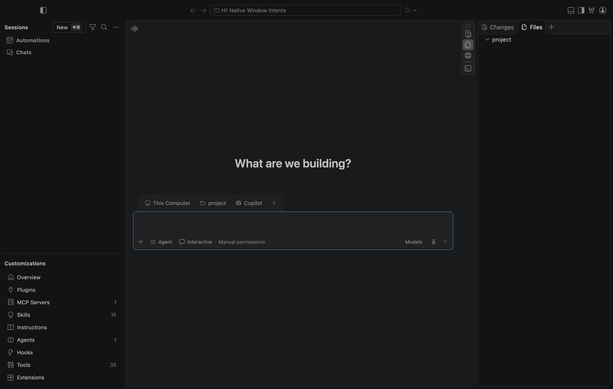

<!-- Copyright (c) Microsoft Corporation. All rights reserved. -->
<!-- Licensed under the MIT License. See LICENSE.txt in the project root for license information. -->

# H1：Mac 原生窗口 API 正向修复与拒绝矩阵

**发现并修复原生正常目录打开被误伤的问题；修复后八种实际 native IPC 请求通过。H1 仍在工程进行中，没有人工通过。**

2026-10-30，Mac arm64 / macOS 27.2（26B123）/ Node 24.22.1 / 原 Electron 43.8.3 / Chromium 150.0.7871.250。先将云端 `96fa875aa51101cf1085382d0182d90aa7111c8d` 更新到本机并编译，原生实测发现问题；修复、回归后提交为 **`20c9dc713855f47b708a7ae2a5e46f3923307096`**，然后按这一确切源码重新启动原生窗口复验。

## 新发现与原调用链修复

用原 launch skill 带一个本地 folder-uri 启动后，从实际 NativeHostService 调用 openWindow 再次打开该正常本地目录，被返回“does not open editor windows”。同轮 canonical Agents workspace 正向请求成功；该记录见 [修复前原生失败](raw/before-fix-native-failure.json)。这不是模型/账户或 Linux IPC 问题。本轮正向目录请求沿用启动项目；切换到不同项目的完整交互仍需另验。

原 `NativeHostMainService` 给每个 API 请求复用 `environmentMainService.args`，其中仍含进程启动时的 folder-uri/位置路径。新窗口分派因此把旧路径当成当前 API 的额外意图，拒绝了合法目录。Native UI 的空窗口请求也存在同类启动路径继承问题。

修复继续使用原服务：一个窄 helper 在 Agent First 的 native API/dialog/menu 边界复制启动参数，只清除旧的位置路径、file-uri 和 folder-uri。新 API 的实际 openables、remote/diff/merge 等 options 仍经过原校验；真实 CLI 路由继续校验原请求。普通产品返回原参数对象，原全局 args 不被修改。调用点覆盖原 native openWindow/openAgentsWindow、文件夹对话框、Mac 新 tab 和受信任 UI 的空窗口；没有新窗口实现、组件副本或手写路径解析器。

## 实际通过项

通过临时原 Action2 命令，从正在运行的原 native DI 获取 INativeHostService；随后逐一调用实际 openWindow IPC，进入真实 NativeHostMainService → WindowsMainService。没有替换主进程或记录网关模拟窗口结果。

| 请求 | 修复后原生结果 |
| --- | --- |
| 单个普通文件 | 明确原产品错误，未增加窗口 |
| 普通 code-workspace 文件 | 明确原产品错误，未增加窗口 |
| 两个本地目录 | 明确原产品错误，未增加窗口 |
| diff 文件请求 | 明确原产品错误，未增加窗口 |
| merge 文件请求 | 明确原产品错误，未增加窗口 |
| canonical Agents workspace 同时携带 remote 意图 | 明确原产品错误，未增加窗口 |
| canonical Agents workspace | 接受 |
| 单个正常本地目录 | **接受，原正常打开路径恢复** |

六次拒绝后均从同一真实原生服务读取窗口 ID，与初始集合相同。末尾仍只有原 Sessions renderer，renderer pageerror=0；不是把新窗口隐藏起来计为拒绝。完整结果见 [result.json](raw/result.json)。没有做真实远程连接；remote 意图为测试用无服务 authority。

原窗口路由 Node 套件 **29 passing**（原 26 + 3 个启动参数/显式 payload/普通产品回归），原客户端增量构建、聚焦源码类型检查、四文件 lint 和完整层次检查均退出 0。类型范围为原 Sessions common/web/desktop/WindowsMain 项目，额外纳入 NativeHostMainService。[日志](raw/routing-tests.log)和 [validation.json](validation.json)记录准确范围；没有重复跑原扩展/Copilot安装或声称全部旧测试新跑过。

## 复现与证据

本机 `.build/native-window-20261030/` 保留空测试 profile、inputs、临时项目和 raw 输出。初始启动仍使用 [launch skill](../../../../../../.agents/skills/launch/SKILL.md)的新隔离配置，项目位于仓库外；原生调用只操作这些测试路径。controller 依赖本机已有 inputs，外机需重建对应路径。

```sh
export PATH="$PWD/.build/mac-toolchain/node-v24.22.1-darwin-arm64/bin:$PATH"
npm run build-fast -- --client-only
node test/unit/node/index.js --run src/vs/platform/windows/test/electron-main/agentFirstWindow.test.ts
node docs/agent-client/evidence/AF/H1/2026-10-30-mac-native-window-api/raw/native-window-controller.mjs
```

- [controller 快照](raw/native-window-controller.mjs)、[修复后结果](raw/result.json)、[修复前实际失败](raw/before-fix-native-failure.json)。
- [build](raw/build-api-args-fix.log)、[29 项回归](raw/routing-tests.log)、[源码类型](raw/types-api-args-fix.log)、[lint](raw/lint-api-args-fix.log)、[完整层次检查](raw/layers-api-args-fix.log)、[文件哈希](raw/SHA256SUMS.json)。

首个 controller 只接受某一处边界的错误文案，在原产品另一处明确拒绝后停止；[该初始断言](raw/initial-controller-assertion.json)不是产品故障。允许两处现有原产品拒绝消息后，完整矩阵才揭示正常目录的真实失败。修复后没有放宽产品断言，只恢复其正向行为。



该矩阵是原 renderer → 主进程 API 路径，不代表物理 OS 拖放、CLI/深链/系统打开全部组合、原生对话框、Mac tab、旧编辑器/untitled/empty hot-exit 恢复已实测。UI 空窗口与对话框调用点获得源码/类型/纯回归覆盖，仍保留各自人工/原生操作门禁。原 Agent 文件写入、Profile、checkpoint、模型批准等未因此替代或标通过。

没有主动登录、复制个人认证 profile、读取/导出令牌或发送模型请求；SDK 全局发现仍有此前记录的隔离限制。GitHub OAuth 仅适用于选用 Copilot 的认证路径，不是本地 Agent 窗口/插件/裁剪测试的必要条件。真实 provider 任务、完整加载归因、IME/VoiceOver、独立 Mac 包和人工验收保留；未合并、未发布，DSH/H2–H4 未启用或通过。
