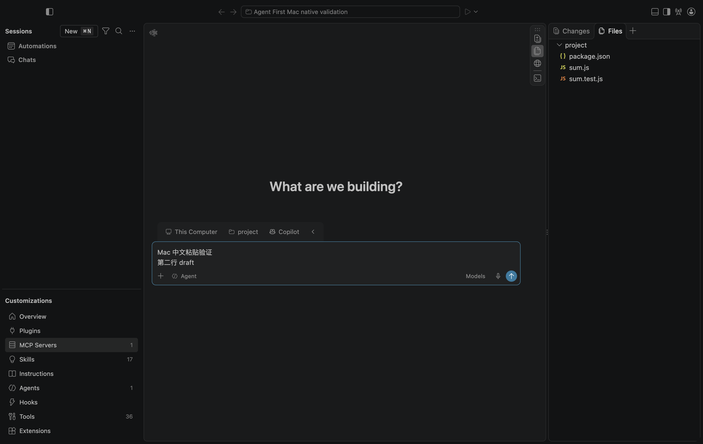
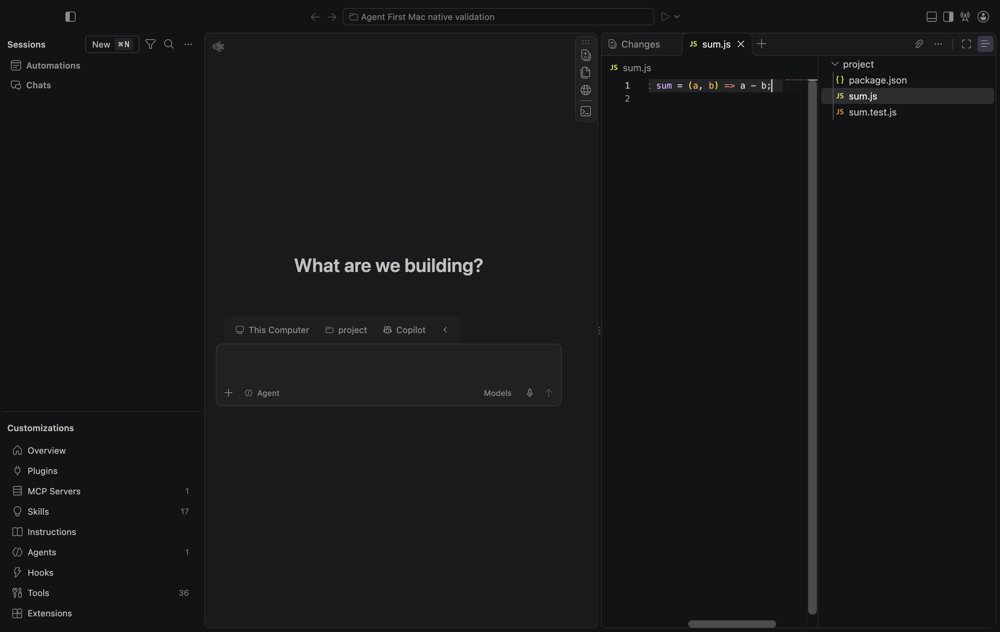

<!-- Copyright (c) Microsoft Corporation. All rights reserved. -->
<!-- Licensed under the MIT License. See LICENSE.txt in the project root for license information. -->

# H1：Mac arm64 原生复验

**结论：原生构建、窗口、中文多行粘贴和一条文件只读审阅路径通过；原生可执行扩展准入失败。H1 仍在工程进行中，未达到人工验收条件。**

测试日期：2026-10-30。实际运行源码为 `0bec73fa99db00cb1bcccadf71326f5c72adc8b2`，测试前工作区干净；本目录只补充测试记录，没有修复产品代码。环境为用户的 Mac arm64 / macOS 27.2（26B123），Node 24.22.1，原 VSC 1.145.0 源码，Electron 43.8.3，Chromium 150.0.7871.250。机器与产物信息见 [validation.json](validation.json)。

本次使用原 Electron 和 `sessions-dev.html`，不是早期 Tauri/React 原型，也不是 Linux 浏览器模拟。它仍是依赖本地源码与构建输出的开发启动，**尚未交付可独立安装的 H1 Mac 应用包**。

## 实际结果

| 检查 | 本机观察 | 范围 |
| --- | --- | --- |
| 原生 Unix IPC | preflight 退出 0 | 只证明该次临时 socket 探针；不是任务成功证明 |
| 原 VSC 完整构建 | `npm run build-fast` 退出 0，client、builtin extensions、Copilot 输出完成 | 本机依赖与原代码构建成功；未重复执行云端全部单测 |
| 原 Electron 运行时 | `npm run electron` 退出 0；实际窗口与原生 Extension Host 启动 | 运行时压缩包和类型文件均匹配仓库 SHA256 |
| 原 Agent UI | 原 Sessions 页面、Sessions/Chats、原 ChatInputPart、Files、命令面板可见；renderer pageerror 为 0 | 没有发送模型请求，也没有替换为自制 UI |
| 中文多行草稿 | 原 Chat 输入框 DOM paste 后，两行中文/英文内容可读回；随后清空 | **只验证粘贴与显示**，没有验证系统中文输入法的 composition/候选框 |
| 原文件只读审阅 | 从 Files 双击临时 `sum.js`，尝试按键 `A` 和粘贴 `H1_WRITE_PROBE`；可见 buffer 与磁盘内容均不变 | 只覆盖这条本地文件打开路径，不扩展为所有编辑/拖放/保存/diff 路径通过 |
| 指定启动模块排除 | 受控 renderer reload 记录到 5445 个本地资源路径；下列五个路径未请求 | 不是冷启动性能报告，也不能证明任务全生命周期内所有服务/worker 未实例化 |
| 产品可执行扩展清单 | renderer 确认 Agent First/Sessions=true、allowlist=[]、非 extension-development；原生 EH 仍进入 Copilot 激活并运行其配置访问代码 | **失败，见下面阻断问题** |
| 真实 Agent 任务 | 未执行 | 没有账户登录、模型、工具批准/拒绝、修改/检查/恢复或多会话成功证据 |

本次未请求的五个指定路径为 `vs/editor/editor.all.js`、Notebook contribution、Interactive contribution、Search Editor contribution、独立 Merge Editor contribution。精确路径和完整本地请求列表见 [native-smoke.json](raw/native-smoke.json)。这不意味着所有共享 Monaco、Notebook、搜索或调试依赖都被删除。





## 阻断问题：原生 enablement 提前放行内置 Copilot

实际窗口公开配置为：

```json
{
  "isSessionsWindow": true,
  "agentFirst": true,
  "executableExtensions": [],
  "isExtensionDevelopment": false
}
```

同一轮原生 Extension Host 日志出现：

```text
2026-10-30 14:58:22.063 [info] ExtensionService#_doActivateExtension GitHub.copilot-chat, startup: false, activationEvent: 'onChatParticipant:github.copilot.editsAgent'
```

随后出现该扩展访问 `github.copilot.chat.languageContext.typescript7.enabled` 的日志。最小原文见 [exthost-activation-excerpt.log](raw/exthost-activation-excerpt.log)。这是触发激活并执行扩展代码的证据，不是认证、模型或完整 Copilot 功能成功的证据。更早的独立运行也观察到相同激活，但本目录归档的是最后这轮。

源码路径：`src/vs/workbench/services/extensionManagement/browser/extensionEnablementService.ts` 的 `_isDisabledBySessionsWindow`，在调用 manifest 准入策略前，对内置 `_chatExtensionId` 直接 `return false`。`extensionManifestPropertiesService.ts` 的 `canExecuteOnSessionsWindow` 虽然检查产品清单，但没有机会拦截这个提前返回。这与实际模式和空清单下的 native EH 观察一致。

同方法中非内置扩展 `EnabledWorkspace` 分支也在最终 manifest 检查之前返回；这是**源码推断的另一条潜在绕过路径，尚未安装外部 VSIX 实测**。不能将其当成本轮已复现的第二个运行时缺陷。

后续修复要求：在原 native enablement 的所有提前放行路径之前施加统一产品可执行扩展准入，覆盖内置聊天、用户 workspace enable、auto-enable、配置覆盖及依赖链；产品未配置此策略时保留上游行为。不得靠把混合扩展整包加入 allowlist 或借用上游 OAuth 身份来掩盖失败。应增加真实 enablement service 回归检查，再回 Mac 复验 native EH；原界面仍须可打开，真实 provider 准入须另做完整审计。

## 复现方法与本机保留物

本机仓库根目录下保留依赖、`out/`、`.build/electron/` 和隔离 Node 工具链。原始测试工作目录为 `.build/agent-first-mac-20261030/`，其中 `test-project.json` 指向仓库外独立的临时项目；其 `sum.js` 是故意保留待 Agent 修复的 `a - b` 示例，本轮没有让模型修复。不要把项目检查未运行写成通过。

在对应源码和依赖已准备的本机，从仓库根执行：

```sh
export PATH="$PWD/.build/mac-toolchain/node-v24.22.1-darwin-arm64/bin:$PATH"
node scripts/agent-first/preflight.mjs
npm run build-fast
npm run electron
```

按 [launch skill](../../../../../../.agents/skills/launch/SKILL.md) 启动隔离原生窗口。源 profile 只含测试设置，不从个人 VSC profile 复制；临时项目必须位于仓库外。此次 launcher 参数如下，其中 `<disposable-project>` 替换为实际临时项目绝对路径：

```sh
bash .agents/skills/launch/scripts/launch.sh \
  --agents --skip-prelaunch \
  --session-title 'Agent First Mac native validation' \
  --source-user-data-dir "$PWD/.build/agent-first-mac-20261030/empty-profile" \
  --disable-workspace-trust \
  -- --use-inmemory-secretstorage --folder-uri 'file://<disposable-project>'
```

`--skip-prelaunch` 只用于原构建/运行时准备已经成功且输出与源码匹配时。独立运行应创建自己的空测试 profile 和项目；该 launcher 本身不会生成可发布应用包。

原生窗口出来后，连接 launcher 返回的临时 CDP 地址，等待 Sessions 页面实际创建，再进行受控 reload。通过 launch skill 的 `focus-chat-input.ts` 选择可见 Chat 输入表面，使用其 `monaco-paste.ts` 相同的 ClipboardEvent/DataTransfer 路径粘贴两行草稿，读回 Monaco view lines；没有调用 Monaco 模型写入 API，没有提交 prompt。然后从 Files 双击测试文件，对原编辑表面做实际按键与相同粘贴，比较前后 view lines 和文件内容。F1 打开命令面板。最后仅收集本轮临时 user-data 下的 EH 日志；测试结束关闭本轮启动的实例。

原生配置仅读取四个上述公开模式字段，没有导出整个 window configuration/userEnv。没有访问个人账户令牌、复制个人认证缓存或发送模型请求。空 User profile **不等于完全隔离所有全局 SDK 发现路径**：界面显示了 SDK 发现的全局 customization 数量，本轮没有把这些数量解释成产品插件准入证明。

## 构建与测试环境问题

- 初始本机缺原 VSC 根依赖、客户端输出和 Electron。首次 fast install 卡在额外 Playwright Chromium 下载；本轮用 Electron CDP，重试时使用 `PLAYWRIGHT_SKIP_BROWSER_DOWNLOAD=1`。
- `github.com` 直连获取 Electron 类型/运行时超时。类型文件从官方 npm Electron 43.8.3 tarball 提取，运行时从官方 GitHub release asset API 获取，均与仓库 `build/checksums/electron.txt` 严格一致；没有换版本或改产品校验。来源、大小和哈希见两个 integrity JSON。
- 直接 `npm run postinstall` 会把子目录安装误变成 run-script；本轮发现后使用 `VSCODE_FORCE_INSTALL=1 npm_command=install node build/npm/postinstall.ts` 完成实际子目录安装。早先退出 0 的错误上下文不作为依赖完成证据。
- 受限执行环境中的 socket/tsx pipe 返回 EPERM；获准的本机执行中 preflight、完整 build 和原生窗口成功。不能把前者当作产品原生故障，也不能把后者扩展为真实任务成功。
- 自动化曾选错输入区域，另一次在窗口创建前连接导致 `No workbench page`；修正输入定位和等待后，本目录最后一轮 controller 退出 0。测试脚本退出 0 只表示观察流程完成，**不表示产品准入测试通过**。

## 证据与后续门禁

- [validation.json](validation.json)：版本、范围、失败和未验证项。
- [preflight-native.json](raw/preflight-native.json)：构建前的原始探针，`compiledClientPresent=false` 是当时真实状态；随后已完成构建，不回写历史结果。
- [build-product-native.log](raw/build-product-native.log)：成功的原完整构建输出。
- [native-smoke.json](raw/native-smoke.json)：最终原界面检查、配置和资源路径；不含认证内容。
- [本轮 controller 快照](raw/native-smoke-controller.mjs)：仅用于复现这轮固定源码观察；依赖上述本机 `.build` 下的空 profile、项目描述与 Node，源码标识固定为 `0bec73f`，后续版本必须重新确认源码并另建报告，不能直接沿用这个标识。
- [runtime integrity](raw/electron-runtime-integrity.json)、[types integrity](raw/electron-types-integrity.json)、[文件哈希](raw/SHA256SUMS.json)。

继续优先修复 native 扩展准入；之后完成原生窗口/系统打开/恢复/拖放矩阵、外部 VSIX 负向激活、产品自有 OAuth/专用账户和真实任务闭环、完整加载归因、独立 Mac 候选包、真实中文输入法与 VoiceOver。此次未执行签名、公证、发布，没有将 H1–H4 标为人工通过。DSH 仍未启用，H2–H4 不受本轮局部通过结果替代。
