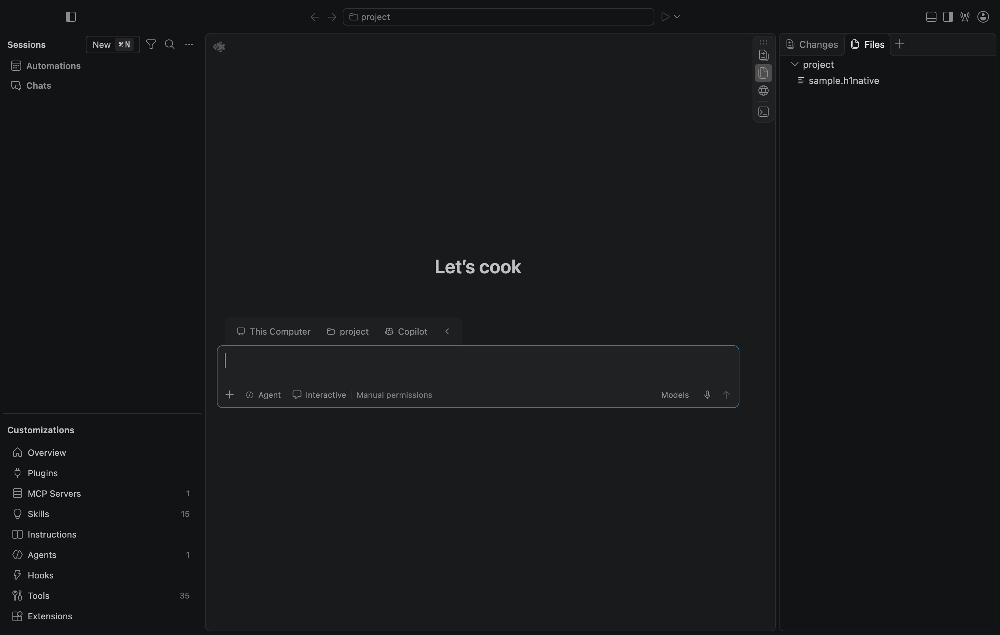

<!-- Copyright (c) Microsoft Corporation. All rights reserved. -->
<!-- Licensed under the MIT License. See LICENSE.txt in the project root for license information. -->

# H1：Mac 外部合成 VSIX 与开发入口准入矩阵

**原生安装、全局/工作区启用拒绝、配置覆盖、保存工作区启用后的重启、开发扩展入口负向检查通过；有实际执行的合成插件对照。H1 仍在工程进行中，未达到人工验收条件。**

2026-10-30，在用户 Mac arm64 / macOS 27.2（26B123）/ Node 24.22.1 / 原 Electron 43.8.3 上执行。准确检出提交为 `78b70f43adc58e72ca832e2069bcabbde6371539`，对应产品源码 `09c03744303e2693251b4dd077851307b1b2d95a`；两者之间只有此前 Mac 证据。复用已验证原构建与运行时，未改产品源码/依赖或重新安装原 VSC 依赖。本轮使用原 Sessions、实际 native DI、原扩展安装/enablement/storage/scanner/EH；没有模拟 ExtensionService 或另写产品插件宿主。

## 实际安装物与结果

三个小型 VSIX 为自建样例：`h1-native-fixture.editor-only`、`h1-native-fixture.mixed`、`h1-native-fixture.dependent`。它们均有真实 main 入口、命令/语言激活、声明 Agents Window 支持；mixed 还声明 languageModelTools，dependent 依赖 editor-only。模块加载和 activate 各在**自身安装目录**追加标记，不访问网络、账户或用户工作文件。另有独立 `development-only` 源目录用于开发入口。

| 场景 | 实际本机结果 |
| --- | --- |
| 本地外部 VSIX 安装 | 三个真实归档经原 `IWorkbenchExtensionManagementService.install` → 本机原安装服务解包、扫描，均返回 valid=true；实际写入本轮隔离扩展目录 |
| 空生产清单 | 三个样例均为原 enablement 的 `DisabledByEnvironment`（数值 2），native 注册表无 main/browser 扩展 |
| 用户全局/工作区启用 | 对每个样例分别请求 EnabledGlobally=12 / EnabledWorkspace=13，**六次 public setEnablement 均拒绝** |
| 配置覆盖 | Agents Window management、capability 开关及 supportAgentsWindow=true、auto-enable ID 列表不能绕过产品清单；独立开发入口轮次还检查 auto-enable=true |
| 激活触发 | 实际 NativeExtensionService 完成 startup、language、command、chat-participant 事件请求，包括此前 Copilot 触发；负向阶段没有样例模块/activate 标记 |
| 可执行对照 | 仅在临时 renderer 的 ProductService 中放行三个合成 ID，public setEnablement 保存 workspace 状态 13；原 native EH 实际执行三个模块和 activate，各标记一次 |
| 保存启用后重启 | 恢复清单 []，原 storage.flush 后退出，**同一临时 profile、同一 workspace ID**重新启动；保存状态仍为 13，但生产有效状态为 2，原 EH 无可执行激活，六个标记的行数/哈希均不增长 |
| 开发扩展入口 | 再用原 code.sh 的 extensionDevelopmentPath 指向独立样例；实际 development=true，原 scanner 扫到 valid main 候选，原 enablement 返回 2；main/activate 标记不存在，native EH 同样无可执行激活 |

保存 workspace 状态由原 setter 和原 storage.flush 创建，没有手写其他组件的存储键。重启使用原 code.sh 和同一测试 profile；这样保留原 Agent 专用 workspace 身份。读取保存状态时，只在一个同步检查中暂时让相同三个样例通过产品匹配、查询原 enablement 状态，然后立即还原 []，不在该检查中发激活请求或改注册表。

对照放行仅限自建样例，记录于 `control.testOnlyProductOverlay`。没有放行整包 Copilot、修改 product.json 或将对照配置当作生产结果。生产两轮重启都重新从磁盘空清单启动；原生宿主的完整同轮日志均记录启动、eager 完成、正常退出 0，没有 `_doActivateExtension`。

## 证据与复现

- [validation.json](validation.json)：版本、通过范围和未验证项。
- [生产安装/对照/保存状态重启](raw/result.json)：所有安装返回值、六次拒绝、实际事件、对照标记、workspace 身份、生产重启日志。
- [开发入口轮次](raw/development-result.json)：原 scanner 候选、实际 development 标志、布尔 auto-enable、同轮完整 EH 日志。其安装/对照字段引用前轮已完成结果，没有重复声称重新安装/执行对照。
- [VSIX 归档与源码](fixtures/)：可直接核对外部归档身份；打包为标准 extension/package.json + main + VSIX 清单，并由原安装器成功读取，未用“复制扩展目录”代替安装。
- [实际 controller 快照](raw/native-vsix-controller.mjs)、[文件哈希](raw/SHA256SUMS.json)。

本机输入/保留物位于 `.build/native-vsix-20261030/`：空 profile、`inputs.json`、生成的临时项目、packages、sources 和 raw 结果。controller 依赖这些已准备的输入；外机需要为自己的临时项目和 VSIX 位置重建 inputs，不能照抄本机临时路径。

```sh
export PATH="$PWD/.build/mac-toolchain/node-v24.22.1-darwin-arm64/bin:$PATH"
node docs/agent-client/evidence/AF/H1/2026-10-30-mac-vsix-matrix/raw/native-vsix-controller.mjs
node docs/agent-client/evidence/AF/H1/2026-10-30-mac-vsix-matrix/raw/native-vsix-controller.mjs --development
```

实际运行中，第一轮完成安装、拒绝和执行对照后，controller 创建重启日志的 WriteStream 尚无文件句柄，导致 Node stdio 错误。它发生在原进程退出之后、新进程启动之前，**是测试控制器错误**。修正句柄打开时序，保留已通过且输入未变的前半轮，使用 `--resume` 完成重启并退出 0；之后开发入口轮次也退出 0。[初始错误](raw/initial-controller-error.json)保留，未计为产品失败或通过。首次完整重跑不需要 --resume。

初次启动使用 [launch skill](../../../../../../.agents/skills/launch/SKILL.md)的新隔离 profile/独立扩展目录/仓库外项目；后续仅重启本轮自己的 profile。没有主动登录、复制个人 profile/认证缓存、读取/导出令牌或发送模型请求。原 SDK 全局账号/customization 发现仍不是完全隔离状态；本轮证据只保存必要测试数据，没有发布无关账户菜单。



## 边界与后续

本轮是合成 **main 入口** VSIX 和一个开发源的确定性准入检查，不是任意 Marketplace 插件兼容证明，也不是 DSH 原插件运行。dependent 在生产空清单中自身就被拒绝；“被准入 dependent 依赖未准入代码”的启动链仍保留云端 service/Worker 范围，不冒充新增 native 对照。单独 browser 入口的原 native WebWorker EH、未配置产品策略时的开发扩展正向对照也尚未在本轮执行。真实模型任务、完整加载归因和原生窗口/恢复/系统打开/拖放仍另有门禁。

本地 Agent 的窗口、插件和裁剪测试不需要 GitHub OAuth。该认证仅在选用 GitHub Copilot 服务路径时适用；后续真实任务应按选定后端完成合法配置，不把 GitHub 注册当作所有本地 Agent 的通用前提，也不把尚未实现的本地模型接入当作现有能力。

原生源码启动不等于独立 Mac 安装包。系统中文 IME、VoiceOver、候选包、真实 provider/model/tools/批准拒绝/取消恢复、多会话和用户人工确认未由此通过；未合并、未发布，DSH 未启用，H2–H4 保留。
