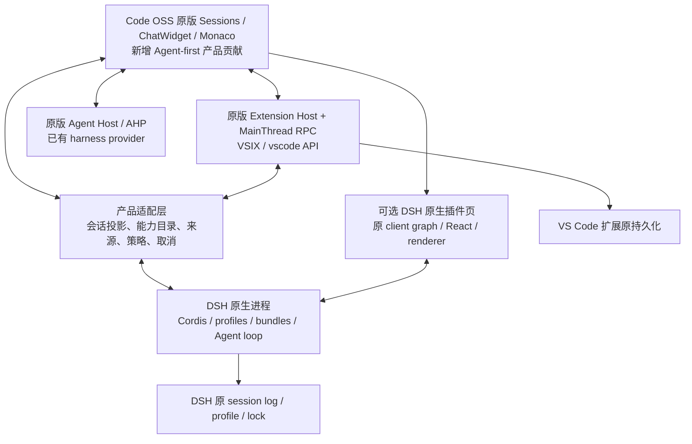

<!-- Copyright (c) Microsoft Corporation. All rights reserved. -->
<!-- Licensed under the MIT License. See LICENSE.txt in the project root for license information. -->

# 以 VS Code 为基础、兼容 DSH 的 Agent 客户端可行性报告

日期：2026-10-29。状态：研究结论与架构建议，尚未实施本报告提出的双运行时方案。本文响应新的优先级：尽量直接复用原组件、保留 VS Code 插件生态、增强 Agent 插件能力，并能持续合并 VS Code 上游。此前的 Tauri 原型和 M0–M8 文档仍是已有交付记录，不能作为本方案已落地的证据。

阅读配套：[验证计划与分阶段推进文档](POC_PLAN.md)、[源码依赖审计](evidence/vscode-import-audit.json)、[代表性插件清单审计](evidence/plugin-manifests.json)、[来源与版本记录](evidence/sources.json)。

## 1. 结论与建议

**构思可行，推荐采用“Code OSS 原版组件与扩展宿主 + DSH 原生运行时 + 有边界的能力桥接”。** 两套插件分别在各自原生环境里运行，产品统一安装入口、会话入口、来源标识和权限提示；工具、上下文和会话控制通过明确接口互通。这比重写 `vscode` API、或把 DSH 插件全部翻译成 VSIX，更接近兼容目标，也更容易跟进两个上游。

“去掉编辑器”建议定义为：默认进入 Agent 工作区，不把常规代码编辑作为主流程；保留 Monaco、文本模型、原版 diff、工作台服务和插件需要的可选界面。原版聊天输入框本身使用编辑器组件，许多插件依赖文档、视图或编辑器服务。若要求分发物里彻底没有这些底层代码，同时又要求原组件和广泛插件兼容，这几个目标存在直接冲突。

建议先以原版 Electron/Code OSS 建立正确性基线，同时验证 Tauri 能否承载**同一套原版 Web Sessions/Workbench**。Tauri 仍值得尝试，但应通过实际插件、原版 Webview、扩展宿主和 Mac 真机门禁后再确定为主容器。当前 React 仿写界面适合作为协议原型，继续扩大会增加回迁成本。

| 目标 | 判断 | 成立条件 |
| --- | --- | --- |
| 原版 Agent/Chat/Sessions 组件直接复用 | 可行 | 保留原组件、原有服务组合及必要 Monaco 依赖，避免复制后独立演化 |
| 广泛兼容 VS Code 稳定 API 插件 | 可行，但须定义支持范围 | 复用完整原生扩展宿主及 MainThread 对端，保留插件需要的产品界面 |
| 原样运行 DSH 后端插件 | 可行性较高 | 使用匹配版本的 DSH/Cordis、profile、bundle、依赖及原生运行时 |
| 原样运行 DSH 前端插件 | 有条件可行 | 承载原 DSH client graph、共享模块和 renderer；不是把 React 组件直接塞进 Code OSS 的 DOM 插槽 |
| 两边工具互调、上下文共享 | 可行 | 类型、权限、取消、生命周期和结果语义逐项适配 |
| DSH 深度插件控制所有 VS Code AI 插件内部循环 | 不能统一承诺 | 仅能控制 DSH 所拥有的会话；其他 harness 必须主动提供公共接口 |
| 一个未修改的插件包在两种 API 下自动运行 | 不成立 | 双生态兼容通过双原生加载器实现；新插件可共享逻辑并提供两个入口 |
| 任意 Marketplace 插件都可获取并使用 | 不成立 | 商店访问、插件许可、服务认证分别受限制，与 API 兼容是不同问题 |
| 保持上游可合并 | 可工程化实现 | 保留 Git 历史、控制修改面积、版本锁定、持续升级演练和回归样本 |
| Tauri 一定更小、更省内存 | 尚无证据 | 必须包含 Node、两个运行时、插件和兼容界面测量，不能只比较壳 |

建议优先级：原组件与行为正确性 → VS Code 插件兼容 → DSH 原生能力与互通 → 上游维护 → 容器与性能优化。Tauri 不需要被放弃，但不能用缩减插件语义来证明它成功。

## 2. 调研范围、方法与证据边界

VS Code 源码审计基于本地提交 `c58fae13e220bb2f9f75c8fcd7afa78480f4f6e4`（与首轮 `28eb53a537f541dcc45fc69ebda9af276e783257` 的原组件审计结果一致），上游基点为 `f0e704e856d22441707652e4f7f263b6162b367a`、源码版本 `1.145.0`。通过 GitHub 官方仓库接口确认该基点确实存在于 `microsoft/vscode`，不是重新导入的无关快照。[上游提交](https://github.com/microsoft/vscode/commit/f0e704e856d22441707652e4f7f263b6162b367a)

DSH 指官方 `deepseek-ai/deepseek-harness`，本次固定提交 `f3803c96974ad4a94195fb97e5c637e9c2a3afe3`，根包版本 `0.2.2-alpha.2`，声明 Node `>=24.9.0`。它处于开发预览期，版本和插件接口仍可能发生不兼容变动；“兼容 DSH”必须附带具体版本/profile，不能扩展成对未来任意 DSH 包的承诺。[DSH 仓库][dsh-root]、[版本声明][dsh-package]

本次完成源码阅读、依赖图静态审计、官方协议和发行规则核对，以及五份代表性插件清单审计。**没有运行本报告的双生态兼容 PoC，没有实测 Cline/Continue 或 DSH 插件在本客户端内工作，没有完成一次双上游升级演练。** 文中的“推荐”“应当”“验收目标”和工期均是方案，不是已有结果。

已有 Tauri Mac 开发包、AHP 通信和确定性测试可继续利用；它们不证明 VSIX、DSH 插件或原版组件已兼容。云端近期另提交了认证与协议故障工作 `c58fae13e220bb2f9f75c8fcd7afa78480f4f6e4`，相关结果以其独立证据为准，也不属于本次兼容性实测。[M2-B 证据](https://github.com/MorCherlf/vscode/blob/c58fae13e220bb2f9f75c8fcd7afa78480f4f6e4/docs/agent-client/evidence/M2/M2-B/README.md)

## 3. 原组件应该如何复用

### 3.1 已核实的源码依赖

| 原实现 | 直接引用数 | 文件内服务装饰器候选数 | 保守源码闭包文件数 | 对方案的含义 |
| --- | ---: | ---: | ---: | --- |
| [Sessions ChatView](../../../src/vs/sessions/contrib/chat/browser/chatView.ts) | 78 | 24 | 2709 | 依靠原工作台服务创建 ChatWidget，不能只取一层视图 |
| [ChatWidget](../../../src/vs/workbench/contrib/chat/browser/widget/chatWidget.ts) | 121 | 42 | 2345 | 涉及聊天、模型、编辑器、上下文、配置及实例化服务 |
| [ChatInputPart](../../../src/vs/workbench/contrib/chat/browser/widget/input/chatInputPart.ts) | 189 | 45 | 2345 | 直接使用 CodeEditorWidget，输入框不是独立 textarea |
| [SessionsList](../../../src/vs/sessions/contrib/sessions/browser/views/sessionsList.ts) | 113 | 33 | 2513 | 需要会话模型、树、菜单、上下文和生命周期 |
| [ExtHost API 实现](../../../src/vs/workbench/api/common/extHost.api.impl.ts) | 125 | 0 | 1009 | API 入口依赖众多原生扩展宿主服务 |
| [MainThread 注册入口](../../../src/vs/workbench/api/browser/extensionHost.contribution.ts) | 101 | 1 | 2627 | 扩展宿主还依赖工作台一侧的 API 对端 |

计数由 [审计脚本](evidence/audit-vscode-imports.mjs) 生成，跟踪相对源码引用，包含类型导入、循环依赖和副作用贡献注册。服务计数是整个文件的候选集合，不等于某个类的构造函数参数数。闭包不是运行时最小依赖、bundle 大小或工作量估算；两个未解析的声明/生成模块记录在 JSON 中。它只能证明这些文件不是可独立复制的轻组件，不能用“2345 个文件”推导一定需要加载全部工作台。

原 [sessions.common.main.ts](../../../src/vs/sessions/sessions.common.main.ts) 已导入 `editor.all`、扩展宿主、编辑器部件、Webview、扩展管理和 terminal。原版 Sessions 并不等于“没有编辑器基础设施”。

### 3.2 复用边界建议

| 层 | 处理方式 | 原因 |
| --- | --- | --- |
| ChatWidget、ChatInputPart、消息/工具渲染、会话列表 | 在原路径直接使用，通过服务与贡献点组合 | 保持原行为、键盘操作、无障碍与上游修复 |
| Monaco、文本模型、diff、URI/文件服务、命令/菜单/主题 | 保留，按真实使用延迟激活 | 聊天输入、变更审阅和插件 API 都可能依赖 |
| ExtHost、MainThread API、RPC、激活与扫描 | 成套复用，按上游版本更新 | 手写 API 子集很难保持隐含行为和对象生命周期 |
| Agent-first 布局、运行时选择、统一插件入口 | 新增产品贡献或薄适配层 | 这是产品差异，应与上游核心分开 |
| 常规编辑区、状态栏、树视图、终端等界面 | 默认收起；按兼容级别提供原版入口或兼容工作区 | 隐藏界面与删除服务的兼容后果不同 |
| DSH 工具、Agent loop、profile、plugin manager、client modules | 使用原实现，不在 VS Code 内重造 Cordis | DSH 插件依赖其服务和事件语义 |
| 当前 React App/Transcript 等 | 保留为原型证据；不作为正式原组件迁移成果 | 它们是新组件，图标、主题和 CSS 来源不能改变这一事实 |

原组件主要采用命令式 DOM 和依赖注入，不要求改写成 React。首选复用原 composition root；只有确实缺失的平台服务才实现适配器。必要修改应尽量贡献上游，避免把原组件复制到 `apps/` 后形成第二份实现。

### 3.3 原版 Sessions 的插件边界也需要补齐

当前 [extensionManifestPropertiesService.ts](../../../src/vs/workbench/services/extensions/common/extensionManifestPropertiesService.ts) 明确把 Views、Debugging、StatusBar、Walkthroughs 列为 Sessions 缺少的能力，并有启用规则：未声明支持、也不在配置/产品允许范围内的可执行扩展，默认不能直接运行。自动启用面向 `languageModelTools`、MCP、skills、agents、instructions、prompts 等贡献，并要求没有缺失能力。

因此“直接启动原版 Sessions”也不能证明广泛兼容。建议逐步恢复原版 ViewContainer/TreeView/WebviewView 等承载面；需要真实编辑器、调试或 Notebook 的插件进入可选兼容工作区，或被明确列为暂不支持。简单取消启用限制、再用空实现返回成功，会掩盖故障。

## 4. VS Code 插件兼容需要保留什么

### 4.1 兼容至少有六个维度

| 维度 | 必须核对的内容 | 常见误判 |
| --- | --- | --- |
| 安装格式 | VSIX、manifest、依赖、版本、目标平台、更新/卸载 | 能解压 VSIX 就算兼容 |
| 运行位置 | Local Node、WebWorker、Remote、`extensionKind` | Node 能运行就能加载所有扩展 |
| API 行为 | `vscode.*`、RPC、事件时序、取消、Disposable、持久化 | 只实现当前样例调用的函数 |
| 产品界面 | 视图、Webview、编辑器、diff、终端、认证提示 | 扩展激活成功就算主要功能可用 |
| Agent 集成 | 公共工具/命令/导出接口，实际归属的 harness | 任意 AI 扩展都可由 DSH 接管 |
| 分发与服务 | 许可、商店来源、登录、服务端产品校验 | 开源 API 意味着商店和服务也开放 |

原 API 实现在 ExtHost 与 MainThread 两侧共同完成，通信使用 [extHost.protocol.ts](../../../src/vs/workbench/api/common/extHost.protocol.ts) 定义的扩展宿主协议。AHP 负责 Agent/客户端通信；它不能替代这套 RPC。[官方扩展宿主说明][vsc-host]

### 4.2 分类支持矩阵

以下是推荐目标，所有运行时结论仍待 PoC。默认主界面只提供 Agent 能力，不代表插件依赖的编辑器和视图可被删掉。

| 插件类型 | Code OSS 原宿主方案 | Tauri + 原版 Web UI 方案 | 所需验证 |
| --- | --- | --- | --- |
| 主题、图标、语言声明 | 原贡献点复用，风险较低 | 可优先验证 | 字体/资源、主题切换、输入语法 |
| 命令、配置、文件、workspace 工具 | 保留原服务后较可行 | 需要正确 Node/Remote 宿主 | URI、文件事件、多根目录、激活和卸载 |
| `languageModelTools`、MCP 贡献 | 可桥接到 DSH，会受原审批约束 | 同时依赖扩展宿主与权限界面 | 模式转换、错误/取消、结果类型、来源 |
| TreeView、WebviewView、插件设置页 | 必须提供原版视图承载面 | 额外验证 Webview 资源与 worker | restore、消息、CSP、iframe、焦点与无障碍 |
| 文档/编辑器/LSP、格式化 | 保留原文档/编辑器服务，复杂操作进入兼容区 | 需要匹配服务与宿主 | 文档生命周期、语言服务、真实编辑语义 |
| Debug、Notebook、自定义编辑器 | 扩展范围显著增加，建议后置支持级别 | 成本与风险更高 | 原工作台功能是否保留和发布范围 |
| 原生 Node 模块、PTY、二进制工具 | 依赖平台与实际宿主 ABI | Sidecar ABI 和打包单独验证 | arm64/x64、签名、依赖、子进程退出 |
| `extensionKind: ["ui"]` 的 Node 扩展 | 原桌面 UI 宿主是自然基线 | 浏览器原工厂没有 LocalProcess，需额外能力 | 不能强行改为 workspace 并宣布兼容 |
| proposed/private API 扩展 | 只对指定版本和许可范围验证 | 同样受限且适配更多 | 明确 API allowlist 和升级失败策略 |
| Microsoft 专有或服务绑定插件 | 不作默认承诺 | 不作默认承诺 | 独立许可和服务授权，见第 10 节 |

稳定 API 是优先兼容面；proposed API 本身允许变化，不能与稳定 API 采用同一承诺。[官方 proposed API 说明][vsc-proposed]

### 4.3 真实插件清单审计说明了什么

| 样本 | 本次读到的版本与入口 | 重要贡献/依赖 | 可得出的结论 |
| --- | --- | --- | --- |
| Continue | `1.3.40`，`./out/extension.js`，`extensionKind: ["ui", "workspace"]` | views、viewsContainers、menus、commands、configuration、languages 等 | 它是带自己的交互面的扩展，不能只接一个工具列表 |
| Cline | `claude-dev 4.1.26`，`./dist/extension.js` | Webview/视图容器、commands、menus、walkthroughs、configuration 等 | 只保留 Sessions 的现有贡献点不足以证明可用 |
| 官方 Cat Coding Webview 示例 | `0.0.1`，`./out/extension.js` | 命令触发 Webview | 适合先验证原 Webview 基础能力，不代表真实复杂插件都能用 |
| DSH LLM Retry | `@deepseek-ai/dsh-llm-retry 0.2.2-alpha.2` | 原生 LLM 服务/重试扩展 | 用 DSH 原生服务验证深层插件，不应降级为一个 tool |
| DSH 插件设置页 | `@deepseek-ai/dsh-client-ui-settings-plugins 0.2.2-alpha.2` | `dsh.client`、locale/settings 注入、Web 平台 | 前端兼容需要原 client composition，不是只运行后端 |

这些是静态 manifest/source 审计，**没有一个样本被本报告标成运行通过**。VS Code 样本为检索日默认分支，确切 blob SHA 与内容摘要记录在 [证据清单](evidence/plugin-manifests.json)；DSH 样本固定到本报告的提交。完整兼容测试要锁定可合法获取的 VSIX/包及内容哈希，再在原版对照环境和本产品执行相同任务。[Continue manifest][continue-manifest]、[Cline manifest][cline-manifest]

## 5. DSH 的插件机制以及如何真正兼容

### 5.1 DSH 的优势是可组合的运行时

DSH 用 Cordis 的 Context、服务注入、typed events 和可撤销 effects 构成运行时。插件通过 `apply(ctx)` 或服务实现、`inject`、事件和 `ctx.effect` 加入组合；工具注册、模型适配、system prompt、session log、Agent loop 等都可由插件提供或替换。它不只是一个可添加工具的聊天 UI。[架构][dsh-architecture]、[Cordis 说明][dsh-cordis]

profile 描述有顺序的 bundle 组合及外部插件，`dsh.profile` 和 `dsh.bundle` 保留原语义；profile/home/CLI patch 还有覆盖顺序。`web`、`headless`、`sdk`、`sdk-minimal`、`acp` 的能力不同，尤其 `sdk-minimal` 是刻意省略完整基础组合的独立树。不能使用最小 SDK 启动成功，就宣称所有 DSH 插件均兼容。

### 5.2 DSH 分类兼容建议

| DSH 能力 | 原生兼容策略 | 与 VS Code 的关系/限制 |
| --- | --- | --- |
| 普通 Node/Cordis 后端插件、profile、bundle | 原样交给 DSH Loader、配置层和依赖解析 | 不转换为 VSIX，不共享两边的 node_modules |
| LLM adapter、重试、prompt/context、compaction | 在 DSH-owned session 内保留原服务/事件 | 无法自动作用于 Copilot/Cline/Continue 的私有循环 |
| 工具、审批、sandbox、workflow、subagent | 保留原执行链；通过窄接口向另一边提供能力 | 不能把安全与状态 hooks 压扁成一次函数调用 |
| 持久化 session 和运行中 Agent | DSH 保持权威状态；产品只持有投影/映射 | session ID、message ID、turn、idle 不能粗暴等同 AHP |
| Web UI 插件 | 用原 DSH client graph/renderer 承载在独立页面或原 Webview 内 | 主题/焦点可适配；组件不自动变为 VS Code 原组件 |
| 动态 host/client runner、会话内编程扩展 | 保留其 VM、guard、审批与卸载规则，后置开放 | 初期不因“追求强支持”扩大任意代码权限 |
| 插件安装/更新/HMR | 调原 plugin manager，保留 profile 锁和实际结果 | 后端已激活、前端同步成功是两个状态 |

原 plugin manager 的失败语义不是“全操作原子回滚”：部分安装/移除步骤成功后，后续失败可能保留已变更状态；UI 必须展示实际安装、激活和重启需要，不能一律写“已恢复”。前端同步也有独立故障状态。[Plugin manager][dsh-plugin-manager]

### 5.3 SDK 能用，但交互控制有明确缺口

官方 TypeScript SDK 以子进程启动匹配版本 `dsh` 的命名 profile，经 stdio newline JSON-RPC 驱动会话，已有会话恢复、事件、审批与用户提问机制，适合第一步接入。[SDK client][dsh-sdk-client]、[SDK server][dsh-sdk-server]

固定版本的公开协议**没有逐会话关闭和中途 prompt-cancel RPC**；关闭 SDK runtime 会影响该进程拥有的会话。低层 `prompt()` 返回的 MessageId 是入队回执，不是该消息完成结果。高层 `run()` 和 `session/wait` 可以收集至所定义的空闲边界，但这不等同每条输入都拥有独立的执行/完成事务。stdout 纯协议也依赖实际 profile 不挂载污染 stdout 的日志器。

因此正式多会话客户端不能把“杀整个进程”包装成“取消当前会话”。建议增加**产品自己维护的 Cordis 协议驱动插件**，优先复用原服务：实际 Agent 暴露 `cancel(cause, options)`、`whenIdle()` 等控制，拥有 AgentHandle 的一方可 `dispose()`。驱动要明确会话所有权、取消范围、排队输入、子 Agent 和关闭的语义；`whenIdle()` 是整个 Agent 的静止边界，不是某个 MessageId 的完成回执。[运行时接口][dsh-agent-runtime]、[Agent 服务][dsh-agent]

第一版可以使用 SDK 验证原插件和事件；完整取消/并发隔离必须另过门禁。协议扩展应版本化并尽可能贡献 DSH 上游。不要依赖私有字段或重写 Agent loop 来填缺口。

### 5.4 DSH 前端需要单独的原生承载环境

DSH 前端包有 `dsh.client`、`platform: web`、`./client` bundle、外部模块和 assets 声明。原 loader 根据 host boot graph、共享模块表和依赖关系加载；graph 还绑定 host 的 version **及 source commit**，跨 release 不应混装。UI renderer 使用自己的 React、slots、locale、remote 等服务。[Client modules][dsh-client-modules]、[UI renderer][dsh-ui-renderer]

可行路径是先在产品内提供独立的 DSH 原生插件页，承载匹配的完整 client graph；之后对值得进入主界面的能力提供明确 slot/贡献适配。把任意 DSH 前端插件重新写成 VS Code 组件，会失去“原样兼容”的价值；把任意 bundle 放进未初始化的 iframe，同样不构成兼容。

本次读到的官方 DSH Desktop 使用 Electron，而非 Tauri。它可以作为 DSH 桌面生命周期/资产加载的参考，但不是 Tauri 已获验证的证据。[Desktop package][dsh-desktop]

## 6. 推荐架构与容器比较

### 6.1 原组件、双宿主、窄桥接

图中适配层是概念边界，具体跨进程端点和 provider 注入位置需 POC-03/04 决定。VS Code Extension Host RPC、AHP、DSH SDK/自有驱动、ACP、MCP 是不同协议；ACP/MCP 只能承载各自定义的能力，不能替代插件 API、前端图或完整 Agent 生命周期。固定版本 DSH ACP 面向自动化、fresh text sessions 等限定场景，不是完整 UI/历史恢复的通用替身。[DSH ACP][dsh-acp]

### 6.2 三条客户端路线

| 方案 | 原组件复用 | VS Code 插件/上游成本 | DSH 接入 | 结论 |
| --- | --- | --- | --- | --- |
| A：原 Electron Code OSS + Agent-first 布局 | 最高，可直接沿用原平台服务 | 最低的额外平台偏差；仍需补 Sessions 缺少的界面 | 独立进程，原 client 可嵌入 | **建议首个正确性基线和初期主线** |
| B：Tauri + 原版 Web Sessions/Workbench + 匹配的 Code OSS Node 服务/宿主 | 可以复用同一套 Web 原组件 | 多一层平台适配；UI-only Node 扩展和 Webview 是重点 | 独立进程；DSH 原 client 也需真机验证 | **有价值的候选容器，过门禁后再升级为主线** |
| C：当前 Tauri + 新 React UI + 手写 VS Code API 子集 | 主要是资产/协议/后端复用 | 兼容面越大，重写与追上游成本越高 | 工具和简单会话较容易，深层兼容继续扩大宿主 | 适合实验，**不推荐继续扩展为本目标的最终架构** |

原源码已经有 [sessions.web.main.internal.ts](../../../src/vs/sessions/sessions.web.main.internal.ts) 和 [web.factory.ts](../../../src/vs/sessions/browser/web.factory.ts)；后者的 `create(domElement, options)` 会启动原 SessionsBrowserMain。这是路线 B 的具体入口，而不是从截图重新写 UI。[Tauri 官方也不限定前端框架][tauri-frontend]。

但 [BrowserExtensionHostFactory](../../../src/vs/workbench/services/extensions/browser/extensionService.ts) 对 LocalProcess 返回 `null`，只创建 WebWorker 或已连接的 Remote 宿主。仅把原网页放入 Tauri，不会自然获得桌面本地 Node 扩展宿主。可以研究自有、同提交的 Code OSS server/local authority，或本地宿主工厂适配；不要直接分发或借用 Microsoft 专有 Remote Server，也不要把 UI-only 插件强行标成 workspace 插件。[OpenVSCode Server][openvscode-server] 证明浏览器加 Code OSS 服务这类架构存在，不证明我们在 WKWebView 上已经兼容。

Tauri PoC 还需实测原 Webview 的 service worker、资源 URI、CSP、iframe、WebWorker、文件访问、终端、外部链接、登录回跳和多窗口生命周期。原 Webview 有自己的 [service-worker/resource 机制](../../../src/vs/workbench/contrib/webview/browser/pre/index.html)；不同 WebKit/自定义 origin 组合可能需要调整承载方式。这里是未验证风险，不是断言 WKWebView 一定不支持。

如果使用本地 HTTP/WebSocket authority，loopback 地址不能当作鉴权。需要验证 Origin/请求来源、连接授权、端点/文件路径范围与进程退出清理；本地监听不能顺带暴露任意工作区或任意命令执行。产品托管的账户/模型长期凭据留在原生端；如原客户端协议需要短期连接票据，应单独设计其作用域、过期和轮换，不与 provider 主密钥混用。受信任第三方插件自行管理的凭据仍遵循其原生存储规则，不能承诺自动接管所有插件认证。

若 B 的关键场景失败，应保留 A 继续产品化，记录 B 的缺口。若 B 全部通过，迁移的是窗口/原生服务承载层；A/B 使用相同组件与回归场景，才能避免第二次 UI 重写。

## 7. 怎样实现“对插件进一步强支持”

### 7.1 既保留原插件，又增加可选择的新能力

建议做一个产品拥有的扩展桥接扩展/SDK，使用稳定 `vscode` API、扩展导出接口和 DSH 原服务；不要全局魔改 `vscode.d.ts`，也不要 monkey-patch 任意插件的内部方法。原 VSIX 无需为安装/原行为重新打包；主动适配的插件可以获得更强 Agent 能力。

| 能力 | 第一个可交付接口 | 必须保留的边界 |
| --- | --- | --- |
| 统一能力目录 | 工具名称、输入 schema、来源、可用 workspace/profile、所需权限 | `vsc:<publisher.extension>:<tool>` / `dsh:<profile>:<tool>` 等命名空间，不按显示名合并 |
| VS Code 能力供 DSH 调用 | 桥接扩展通过原 `vscode.lm.tools/invokeTool` 调用已公开的工具 | 原工具的确认、取消、错误和结果类型继续有效 |
| DSH 能力供 VS Code 调用 | 桥接扩展注册原 `languageModelTools` 或显式导出的窄接口 | 执行仍经过 DSH 原策略链；不能由显示层批准绕过 deny |
| 上下文 | 显式提供文档/选区/诊断/变更的快照与 URI、版本 | workspace trust、大小、隐私范围和文件版本都要明确 |
| 插件贡献的 Agent 能力 | DSH 服务、事件、scoped tool、prompt/compaction provider | 深度 hook 只作用于拥有该 hook 的运行时 |
| 前端扩展 | 原 VS Code views/webviews；原 DSH client graph | 跨前端统一外观是适配工作，不修改原包冒充原生兼容 |
| 调试与诊断 | 激活图、调用链、权限决策、加载失败、profile/版本、卸载原因 | 不记录密钥、原始敏感聊天和任意环境变量 |

接口设计可以借鉴 DSH 的可组合服务、可撤销注册、配置分层、作用域和工具执行链，但不能在第一版就发明完整第三套插件格式。面向新插件可提供共享纯 TypeScript 业务逻辑 + VS Code 包装入口 + DSH 包装入口；共享的是逻辑，两个原生生命周期仍分别实现。

### 7.2 工具桥接中一个已经确认的可行点

本地 [vscode.d.ts](../../../src/vscode-dts/vscode.d.ts) 明确允许任何扩展在自定义流程中全局调用 `lm.invokeTool`，不要求一定来自 ChatRequest。外部流程使用 `toolInvocationToken: undefined`，确认仍由 VS Code 处理，只是不自动关联原聊天中的进度/内联展示。有效 token 只能来自真正的 ChatRequest，桥接器不能伪造。[官方 API][vsc-api]

因此 DSH 调用 VS Code 工具并非因 token 而被彻底阻断。需要先验证的是：工具是否依赖真实 chat 上下文、确认如何展示、取消是否传递，以及 Text/PromptTSX/二进制等结果是否能无损或明确拒绝地映射。未知结果不能简单 JSON/stringify 后宣称语义兼容。

### 7.3 执行与权限必须有唯一归属

DSH 工具管线包含 pre-execute、guard、execute、post/project 和最终结果等阶段；桥接不得跳过原 guard 或让事后 hook 改写已否决的动作。[工具执行链][dsh-tool-pipeline]

每次调用要记录执行拥有者、来源插件、工作区、实际参数摘要、request/session、取消 generation 和幂等标识。拒绝优先；批准只对当前请求及其具体参数有效；取消/断连后到达的批准必须失效。跨桥工具避免再次导回自己形成循环；崩溃后对结果未知的写操作不自动重放。原安全系统仍可要求二次确认，只有正式的双向审批适配才可合并提示，不能为减少弹窗静默批准。

### 7.4 不要混淆两边的状态所有权

VS Code 扩展状态、AHP 会话和 DSH append-only session log 分别保留原持久化规则。产品可以统一列出和筛选会话，但必须带 runtime/profile/原始 ID；恢复时交回拥有者处理。不要为了统一 UI 先把事件转换成一份有损聊天数组，再把它当作两边权威历史。

Cline、Continue 等带自身 Agent loop 的插件，首先作为原生 VS Code 扩展运行。想共享其内部工具或让 DSH 控制其循环，需要它们提供稳定公共导出、MCP、受支持的命令或专门适配。安装兼容并不自动带来内部编排兼容。

## 8. 持续合并两个上游的工程方案

### 8.1 VS Code：保留历史、缩小核心修改、每次演练升级

建议保留 `microsoft/vscode` 为只读 upstream remote，记录产品版本的准确基点。产品提交集中于独立贡献目录、桥接扩展、构建/产品配置和少量平台适配；避免大规模删除原 editor/workbench 文件、全仓格式化、重命名或复制原组件。当前已有原始 Git 历史，是可以继续利用的基础。

| 修改位置 | 规则 | 升级检查 |
| --- | --- | --- |
| `src/vs/base`、`platform`、`editor`、`workbench/api` | 默认随上游；必要修复独立小提交并优先上游化 | 每次升级审阅差异、RPC/API 变化和回归 |
| 原 Sessions/Chat 核心组件 | 直接使用；通过已有 service/registry 接入 | 原始文件来源、行为/视觉/无障碍对照 |
| 产品 Agent 布局与 DSH provider | 新贡献；遵守 sessions 可依赖 workbench 的层次规则 | 不从 workbench 反向导入 sessions，验证层次 |
| 容器/native service 适配 | 单独目录与明确接口，A/B 平台分离 | 平台接口 diff、Webview、宿主、登录和签名 |
| bridge 与产品新增插件 API | 自有包/扩展，版本化契约 | 双上游集成测试和旧插件兼容 |
| product/品牌/扩展源/打包 | 产品配置中管理，保留原许可 | 每个平台生成物与许可/更新清单 |

建议流程是每周做一次升级集成尝试、每个选定上游发布建立升级分支，安全修复按影响优先处理。这是建议的维护制度，本次没有创建定时任务。已共享/发布分支不靠强制推送整理历史；升级在新分支合入上游、解决冲突、跑门禁，再通过 PR 合入。

每次升级必须记录：上一个/新的 upstream SHA、产品改动路径与冲突文件、稳定/proposed API diff、ExtHost/MainThread/AHP 协议变化、原 UI 对照、插件矩阵结果、失败与回退。Git 无冲突不等于行为兼容；建议维护核心修改行数、热区重叠、升级耗时和未解决冲突数量的趋势，而不承诺固定百分比“零维护”。

### 8.2 DSH：锁定运行时整体，不逐个漂移核心包

DSH 作为单独可构建/分发的依赖或独立上游 checkout 管理；两种获取方式择一并记录 provenance，不把整个源码复制进自有包后随意改动。profile、bundle、Cordis/vendor、server、SDK、client module graph 要用匹配 release/commit。外部插件另锁版本、完整性和依赖，兼容范围写入产品锁文件。

不共享 VS Code 与 DSH 的 node_modules；不要用依赖提升偶然解决两个生态的版本冲突。可研究共用一个受管理的 Node 可执行文件，但需同时满足版本、原生模块 ABI、插件运行方式和生命周期验证；进程与包解析仍隔离。本机 Node `24.22.1` 满足本次 DSH 声明的最低版本，仅此不能证明全部依赖或原生模块兼容。

DSH 升级重点审阅 service/event/tool pipeline、Agent 控制、profile patch、session schema、plugin manager 和 client release graph。数据迁移前做备份，旧应用不能直接打开已不可逆迁移的数据；回滚应恢复整组运行时、插件锁与相应数据，而非只回退窗口程序。

建议发行版本元组至少包含：`product + vscode SHA + container version + extension API/proposals + DSH SHA/version + profile/bundles/lock + bridge protocol + data schema`。完整记录存放在 build manifest 和诊断页，而非让用户猜测某个 npm 包的版本。

### 8.3 一次真实升级演练是架构门禁

原组件基线出来后，应选择一个确实不同的 VS Code 上游提交和一个不同 DSH 提交，分别完成隔离升级、冲突解决、插件/会话回归及回退演练。不能以 rebase 同一提交、只改版本号或锁文件来代替。若升级反复要求修改大量原 Chat/API/DSH 核心，则说明适配边界需要收缩，参见 POC-06。

## 9. 安全与运行成本

普通 VS Code Node 扩展和普通 DSH Node 包都是在受信任宿主内运行的代码。Tauri capability、跨进程 RPC、Cordis disposer 以及工具审批，都不自动给任意 Node 插件提供完整 OS 文件/网络隔离。DSH 动态 runner 另有 VM/guard 机制，应按原实现保留，而不是把普通包与动态沙箱混为一谈。[DSH 安全边界][dsh-safety]

建议第一阶段明确支持“用户安装的受信任插件”，保留两边原 trust/approval/运行限制。如果未来承诺恶意插件隔离，需要单独的 OS 隔离、宿主/权限设计与兼容评级，不能用兼容模式自动提升权限。包安装还涉及 pnpm/npm lifecycle scripts，安装批准与运行批准应分开记录。

第三方插件的网络与 telemetry 也不会因为换成 Agent UI 自动消失。统一管理入口应显示插件来源、实际运行位置和产品能观察到的行为；无法观察或控制的插件内部请求明确列为边界。不要从工具审计日志推断已审计普通 Node 插件的全部活动。

双生态会增加代码体积、Node 进程、缓存、日志和升级矩阵。原组件延迟激活能降低部分启动工作，却不意味着磁盘包也按相同比例减少；同时运行原 DSH client 和 Code OSS UI 还会有两套前端框架/状态成本。应按空载、VS Code 插件启用、DSH 启用、两边并用、Webview 打开等场景，统计所有子进程和实际落盘依赖。

已交付的旧版 Mac Tauri 开发包约 `456.81 MiB`，功能尚不完整；该数字不能证明本方案优于完整 Code OSS。原计划“安装体积 -40%、空闲内存 -30%、冷启动 p95 -25%”仍未实测。若保留广泛插件兼容，应先以同能力、同插件、同模型/任务重新建立基线，再评审这些目标是否仍合理，不能把关掉功能的结果当作通过。

## 10. 发行、插件来源与许可边界

技术上兼容 VS Code API，不等于可直接使用 Visual Studio Marketplace。当前官方 FAQ 明确限制 Code OSS fork 等替代产品访问该商店；从商店取得的 Microsoft/关联方扩展也有 Visual Studio 产品范围限制。各插件另有自己的许可证与服务条款。[VS Code FAQ][vsc-faq]、[Marketplace 使用条款][marketplace-tou]

建议使用 Open VSX、自有目录及发布者授权的 VSIX/源码构建，逐项保留来源、许可、完整性和更新方式。Open VSX 不会自动包含所有 Marketplace 插件；手工下载 VSIX 也不会绕过原许可。不要通过伪装产品身份、复用 Microsoft 商店配置或他人 OAuth client ID 达到兼容。[Open VSX 配置文档][openvsx]

DSH 仓库声明 MIT，但分发物中的依赖、模型服务、二进制工具和外部插件仍需逐项记录。Code OSS MIT 与微软品牌版产品不是同一发行物。现有 Copilot SDK 集成也应按自己的 SDK/runtime 与服务授权路径单独核对；Marketplace 的限制不能被推导成所有 SDK 均不可用，开源 SDK 也不自动授权全部配套运行时。以上仅记录技术选型相关的已公开限制；正式发行还需要完成具体依赖和授权清单。

## 11. 推进路线、目标和成本估算

详细任务、输入、交付物、判退条件与验收见 [POC_PLAN.md](POC_PLAN.md)。建议先做验证阶段，再冻结产品范围，不把“全部插件兼容”当作一个无法验收的大目标。

| 阶段 | 交付目标 | 核心退出门禁 | 依赖 |
| --- | --- | --- | --- |
| F0：范围与原生基线 | 原版组件调用链、原版 Electron Agent-first 基线、固定插件/运行时样本 | 原 ChatWidget/Input/列表真实实例；无需改写才能完成核心交互 | 本报告、干净可复现构建环境 |
| F1：容器与双宿主 PoC | 原 Web UI 的 Tauri 实验、VSIX 端到端、原生 DSH profile/控制验证 | POC-01–04 必测项逐项通过；失败选择原生基线继续 | F0 |
| F2：可用的双生态 Alpha | 完整原扩展加载/视图、DSH 原生包、版本化工具桥、会话投影 | 冻结的 20 个 VSC 样本与 10 个 DSH 场景各自必测项通过 | F1 的架构决策 |
| F3：强插件支持与维护 | 原 DSH client 插件、公开产品 SDK、诊断、双上游演练 | POC-05/06；卸载/取消/恢复/升级不破坏另一边 | F2 |
| F4：Beta 与发行 | Mac 实机、权限/许可/性能、签名更新与回滚 | POC-07；发布支持矩阵可复现，所有阻断项清零 | F3 |

计数是建议冻结的覆盖目标，不是兼容率结果。样本中的功能必测项要与原生对照环境一致；不支持的类别先写清楚，不能在失败后临时移出分母。DSH 的 10 个场景应覆盖实际包、profile 及前后端组合，而非十个等价空插件。

规划估算：熟悉 VS Code 工作台和 Node 插件系统的 2–3 名工程师，预留约 2–4 周完成首轮 PoC；通过关键门禁后，限定范围 Alpha 约再需 6–10 周，带双上游与 Mac 发行门禁的 Beta 约再需 6–12 周。这是基于任务拆分的粗估，没有历史工时统计，不能相加后当作交付承诺。Tauri 平台缺口、DSH 预览版变化、原生模块/专有服务和编辑器类插件范围，均可能显著延长。单人推进应明显下调同时展开的范围。

建议职责至少覆盖：Code OSS/上游维护、DSH/协议桥、桌面平台与验证。即使由同一人兼任，也需为上游升级和插件回归持续留出时间，否则“以 VSC 为基础”会逐步变成难以升级的固定 fork。

## 12. 风险、判退条件与当前工作的去向

| 风险 | 影响 | 处理和判退条件 |
| --- | --- | --- |
| 删除 editor/workbench 过多 | 原组件与真实插件同时失效 | 恢复原服务，改为默认隐藏；仍要求彻底删除则缩小兼容承诺 |
| 把原 Sessions 当成全部插件平台 | 视图/调试/状态栏插件无可用入口 | 恢复原承载面或提供兼容工作区，必测场景不能靠放宽启用规则通过 |
| Tauri 缺本地 UI Node host/Webview 行为 | 需要大量平台重写 | 两轮有边界的 PoC 后评审，A 继续作为产品主线 |
| DSH SDK 取消语义不完整 | 一个会话停止影响其他会话 | 自有原生协议驱动或贡献上游；未解决前不验收多会话控制 |
| 深层插件作用于错误 harness | 用户以为 hook 生效，实际绕过 | UI 显示运行时与能力支持，禁止静默降级 |
| 核心补丁扩散/上游升级失败 | 长期维护与安全修复成本增加 | 每阶段升级演练；冲突热区回归到 service/registry 适配 |
| 插件来源/服务授权缺失 | 可安装却不可合法分发或使用 | 选定授权来源、替代包或从首版范围排除，不伪装产品 |
| 仅比较容器体积 | 性能决策失真 | 同功能、同插件、全部进程与依赖纳入测量 |

当前 `packages/agent-host`、`agent-client-core`、Rust supervisor 中已完成的协议、进程管理、错误处理与认证隔离工作，可作为路线验证和相应实现的参考/资产；不同容器仍需核对生命周期和服务边界，不能保证每段代码原样保留。当前 React 界面暂不扩大，原主题/图标资产继续可用，但不计作原组件迁移。

本报告建议替代早期“缩小到 Agent API 子集、删除编辑器依赖”的技术方向，但**没有擅自把原 G02/G10 等门禁改成已通过，也没有把 Tauri 改成已放弃**。下一步应完成 F0/POC 后记录 ADR，再同步 SOLUTION、GOALS、ROADMAP、UI_MIGRATION 和各里程碑。此前真实验证记录保留，未验证功能继续明确标注。

## 13. 建议形成的产品定位

产品可以是一个以 VS Code 原生组件与扩展兼容为基础的 Agent 工作台，默认聚焦任务与审阅，按需打开插件需要的原始界面；DSH 提供可组合、可深度扩展的 Agent 运行时。两套插件保持原生语义，产品负责发现、连接、呈现和诊断。

这个定位同时保留了 VSC 生态与上游积累、DSH 深度插件的优势，也给 Tauri 留出了通过证据赢得采用的空间。首要工程任务是建立原组件和原插件的基线，而不是继续扩大另一套仿写界面。

## 14. 主要一手来源

源码快照、文件内容哈希和检索时间见 [sources.json](evidence/sources.json)。外部默认分支链接随时间变化；DSH 关键链接固定到本次提交。结论中涉及尚未运行的组合均已标为推断或方案。

- VS Code 本地原实现：Sessions 入口、Web factory、ChatWidget、ChatInputPart、ExtensionHost/MainThread、Sessions 扩展启用规则和 `vscode.d.ts`，见上文相对源码链接。
- 官方 VS Code：[扩展宿主][vsc-host]、[API][vsc-api]、[Webview][vsc-webview]、[proposed API][vsc-proposed]、[发行 VSIX][vsc-publishing]、[FAQ][vsc-faq]、[Marketplace 条款][marketplace-tou]。
- 官方 DSH：[架构][dsh-architecture]、[Cordis][dsh-cordis]、[工具执行链][dsh-tool-pipeline]、[SDK client][dsh-sdk-client]、[SDK server][dsh-sdk-server]、[Agent 控制][dsh-agent-runtime]、[client modules][dsh-client-modules]、[plugin manager][dsh-plugin-manager]。
- 其他项目原始资料：[Tauri 前端配置][tauri-frontend]、[Open VSX][openvsx]、[OpenVSCode Server][openvscode-server]、[Continue manifest][continue-manifest]、[Cline manifest][cline-manifest]。

[dsh-root]: https://github.com/deepseek-ai/deepseek-harness/tree/f3803c96974ad4a94195fb97e5c637e9c2a3afe3
[dsh-package]: https://github.com/deepseek-ai/deepseek-harness/blob/f3803c96974ad4a94195fb97e5c637e9c2a3afe3/package.json
[dsh-architecture]: https://github.com/deepseek-ai/deepseek-harness/blob/f3803c96974ad4a94195fb97e5c637e9c2a3afe3/docs/architecture.md
[dsh-cordis]: https://github.com/deepseek-ai/deepseek-harness/blob/f3803c96974ad4a94195fb97e5c637e9c2a3afe3/docs/cordis-primer.md
[dsh-tool-pipeline]: https://github.com/deepseek-ai/deepseek-harness/blob/f3803c96974ad4a94195fb97e5c637e9c2a3afe3/docs/tool-execution-pipeline.md
[dsh-plugin-manager]: https://github.com/deepseek-ai/deepseek-harness/blob/f3803c96974ad4a94195fb97e5c637e9c2a3afe3/packages/boot/plugin-manager/README.md
[dsh-sdk-client]: https://github.com/deepseek-ai/deepseek-harness/blob/f3803c96974ad4a94195fb97e5c637e9c2a3afe3/packages/sdk/client/README.md
[dsh-sdk-server]: https://github.com/deepseek-ai/deepseek-harness/blob/f3803c96974ad4a94195fb97e5c637e9c2a3afe3/packages/sdk/server/README.md
[dsh-agent-runtime]: https://github.com/deepseek-ai/deepseek-harness/blob/f3803c96974ad4a94195fb97e5c637e9c2a3afe3/packages/core/agent/src/runtime-types.ts
[dsh-agent]: https://github.com/deepseek-ai/deepseek-harness/blob/f3803c96974ad4a94195fb97e5c637e9c2a3afe3/packages/core/agent/src/index.ts
[dsh-client-modules]: https://github.com/deepseek-ai/deepseek-harness/blob/f3803c96974ad4a94195fb97e5c637e9c2a3afe3/packages/client/modules/README.md
[dsh-ui-renderer]: https://github.com/deepseek-ai/deepseek-harness/blob/f3803c96974ad4a94195fb97e5c637e9c2a3afe3/packages/client/ui-renderer/README.md
[dsh-desktop]: https://github.com/deepseek-ai/deepseek-harness/blob/f3803c96974ad4a94195fb97e5c637e9c2a3afe3/apps/desktop/package.json
[dsh-acp]: https://github.com/deepseek-ai/deepseek-harness/blob/f3803c96974ad4a94195fb97e5c637e9c2a3afe3/packages/acp/acp/README.md
[dsh-safety]: https://github.com/deepseek-ai/deepseek-harness/blob/f3803c96974ad4a94195fb97e5c637e9c2a3afe3/SAFETY.md
[vsc-host]: https://code.visualstudio.com/api/advanced-topics/extension-host
[vsc-api]: https://code.visualstudio.com/api/references/vscode-api
[vsc-webview]: https://code.visualstudio.com/api/extension-guides/webview
[vsc-proposed]: https://code.visualstudio.com/api/advanced-topics/using-proposed-api
[vsc-publishing]: https://code.visualstudio.com/api/working-with-extensions/publishing-extension
[vsc-faq]: https://code.visualstudio.com/docs/supporting/faq
[marketplace-tou]: https://aka.ms/vsmarketplace-ToU
[tauri-frontend]: https://v2.tauri.app/start/frontend/
[openvsx]: https://github.com/eclipse-openvsx/openvsx/wiki/Using-Open-VSX-in-VS-Code
[openvscode-server]: https://github.com/gitpod-io/openvscode-server
[continue-manifest]: https://github.com/continuedev/continue/blob/main/extensions/vscode/package.json
[cline-manifest]: https://github.com/cline/cline/blob/main/apps/vscode/package.json
